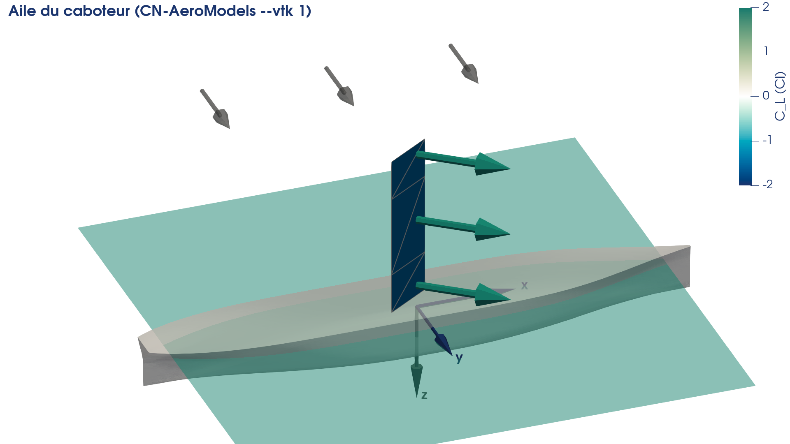

<!-- destinations: github -->
<!-- word : par generer_td_S1.py, conversion mécanique des formules (ARB-EGN-S7-041) -->
# TD 1 — Aérodynamique avec CN-AeroModels · fiche élève

**EGN-S7 Propulsion assistée par le vent · séance de TD S1 · durée 2 h.** Prérequis : le cours du matin (deck S03 sur Vega,
diapos 5 à 22 : vent apparent, profil 2D, passage à l'aile 3D). Cette fiche est aussi dans le
dépôt public du TD, `docs/TD-S1_Aerodynamique.md` : <https://github.com/ChrisVhk/TD-Propulsion-Velique>.

Les exercices sont tirés de la banque d'exercices d'EGN-S7 (A01 à A04). Chaque exercice porte son **niveau** :
**niveau 1**, application directe d'une définition ou d'une formule ; **niveau 2**, enchaînement de plusieurs étapes
ou lecture critique d'une source.

# Objectifs

À la fin de la séance, vous savez :

- calculer un vent apparent (vitesse AWS et angle AWA) à partir du vent vrai et de la vitesse du navire (A01, niveau 1) ;
- lire la convention de direction du vent d'un fichier d'entrée de CN-AeroModels, et ne pas la lire à l'envers (A02,
  niveau 1) ;
- évaluer le nombre de Reynolds d'une voile de cargo et dire ce qu'il implique pour l'usage d'une table de profil (A03,
  niveau 1) ;
- lire une table de profil réelle : maximum de portance, décrochage, finesse, effet du nombre de Reynolds, et
  retrouver dans les sorties de l'outil le nombre de Reynolds qu'il utilise réellement (A04, niveau 2) ;
- installer CN-AeroModels et vérifier votre installation sur deux cas dont le résultat est connu ;
- ouvrir dans ParaView les fichiers de visualisation de l'outil et y lire le sens des efforts et le repère NED
  (manipulation 3).

# Vos armes : les formules utiles (deck S03)

**Vent apparent** (deck S03, diapos 6 à 10). Le vent apparent est le vent vrai moins la vitesse du navire :
$`V_{app} = V_{vrai} - V_{navire}`$. Avec TWA compté depuis l'avant du navire (0° : vent debout) et BS la vitesse du navire :

- $`\mathrm{AWS}^{2} = \mathrm{TWS}^{2} + \mathrm{BS}^{2} + 2 \cdot \mathrm{TWS} \cdot \mathrm{BS} \cdot \cos\,\mathrm{TWA}`$ ;
- $`\tan\,\mathrm{AWA} = \mathrm{TWS} \cdot \sin\,\mathrm{TWA} / (\mathrm{TWS} \cdot \cos\,\mathrm{TWA} + \mathrm{BS})`$.

Cas limites : vent debout, $`\mathrm{AWS} = \mathrm{TWS} + \mathrm{BS}`$ ; vent arrière, $`\mathrm{AWS} = |\mathrm{TWS} - \mathrm{BS}|`$.

**Convention de l'outil** (deck S03, diapo 12). Le fichier d'entrée donne la direction **vers laquelle** le vent souffle,
dans le repère NED (nord, est, bas) : $`\beta = 180^{\circ} + \mathrm{TWD}`$, où TWD est la direction **d'où** vient le vent.

**Angle d'attaque** (deck S03, diapos 9 et 11). Pour une unité vélique, l'angle d'attaque AoA est l'angle de vent
apparent corrigé du réglage m de l'aile : $`\mathrm{AoA} = \mathrm{AWA} + m`$, avec les angles signés de l'outil.

**Profil 2D** (deck S03, diapos 14 à 16). Pour un profil de corde c dans un écoulement de vitesse V, par unité d'envergure :

- $`L = \frac{1}{2} \rho C_{L}(\alpha, \mathrm{Re}) c V^{2}`$ et $`D = \frac{1}{2} \rho C_{D}(\alpha, \mathrm{Re}) c V^{2}`$ ;
- $`\mathrm{Re} = \rho V c / \mu = V c / \nu`$ ;
- finesse : $`C_{L} / C_{D}`$.

**Données communes** (fichier `aile-caboteur.yml`) : $`\rho_{air} = 1{,}225`$ kg/m³ ; $`\nu_{air} = 1{,}48 \cdot 10^{-5}`$ m²/s.
14 nœuds = 7,2016 m/s ; 20 nœuds = 10,288 m/s.

# Matériel

Tout se fait dans **Ubuntu sous Windows (WSL)**, dans le terminal Ubuntu, sauf la visualisation (manipulation 3),
qui se fait dans **ParaView pour Windows**.

- **Le dépôt du TD**, `TD-Propulsion-Velique` (public, GitHub) : la fiche de chaque séance (`docs/`), les scripts
  d'installation et de vérification (`scripts/`), un dossier par TD (ici `TD1_aerodynamique/`, un sous-dossier par
  manipulation : tableau ci-dessous) et ce qui sert à plusieurs TD (`communs/` : exemples du LHEEA, coque du caboteur).
- **L'outil CN-AeroModels, version v0.5.1, binaire Linux** (LHEEA, Centrale Nantes / CNRS ; licence Eclipse Public
  License 2.0). Le script `scripts/installer_cnaero.sh` le télécharge sur la page *Releases* officielle,
  <https://gitlab.com/lheea/CN-AeroModels/-/releases>, et l'installe ; l'enseignant ne redistribue pas le binaire.
- **Python 3** avec les modules `yaml` et `matplotlib` (installés par le même script), ou à défaut un tableur.
- **ParaView pour Windows** (logiciel libre de visualisation, Kitware), installé selon le pré-vol (étape ⑤).
- Une calculatrice.

| Manipulation | Dossier (dans `~/TD-Propulsion-Velique/`) | Commande |
|---|---|---|
| 0 — installer l'environnement et l'outil | dossier du dépôt (`scripts/`) | `bash scripts/installer_cnaero.sh` |
| 1 — vérifier l'installation (aile elliptique) | dossier du dépôt (`scripts/`) | `python3 scripts/verifie_mon_install.py` |
| 2 — le cas de l'aile du caboteur | `TD1_aerodynamique/manip2-3_aile-caboteur/` | `bash lancer.sh aile-caboteur.yml` |
| 3 — le cas dans ParaView | `TD1_aerodynamique/manip2-3_aile-caboteur/` | `bash lancer.sh aile-caboteur.yml --vtk 1`, puis `vue.pvsm` dans ParaView |
| 4 — tracer la table de profil | `TD1_aerodynamique/manip4_table-de-profil/` | `python3 tracer_table.py` |

Table: Tableau 1 — Où travailler : un dossier par manipulation

Chaque dossier contient ce que sa manipulation demande ; **les sorties de calcul vont dans son sous-dossier
`sorties/`** : `lancer.sh` lance l'outil dans `sorties/`, affiche tout ce qu'il écrit à l'écran et garde cette sortie
écran dans `sorties/<fichier>_ecran.txt` (pour y chercher un message).

**Déroulé de la séance.** De 0:00 à 0:40, un membre du binôme installe (manipulations 0 et 1) pendant que l'autre
commence A01 et A02 à la main ; puis la manipulation 2 et, juste après, la manipulation 3 (ParaView, 15 min) ;
puis, jusqu'à 2:00, A03, le tracé de la table (manipulation 4) et A04. Si l'installation coince, continuez les
exercices : ils se font tous sans l'outil.

# Manipulations pas à pas

## Manipulation 0 — Installer l'environnement et l'outil

Suivez `docs/00_PRE-VOL_Installation.md` du dépôt du TD. En résumé :

1. **WSL et Ubuntu** : par le script du cours d'informatique appliquée S5 (dépôt public
   `Informatique-Appliquee-S5`, `scripts/installer_poste.ps1`), expliqué dans le pré-vol. Si Ubuntu est déjà installé
   sur votre poste, passez à l'étape 2.
2. **Le dépôt du TD**, dans le terminal Ubuntu :

   ```bash
   cd ~
   git clone https://github.com/ChrisVhk/TD-Propulsion-Velique.git
   cd TD-Propulsion-Velique
   ```

3. **CN-AeroModels et les modules Python** :

   ```bash
   bash scripts/installer_cnaero.sh
   source ~/.bashrc
   ```

**Auto-contrôle** : lancé sans argument, l'outil doit répondre `Please specify an input file` :

```bash
CN-AeroModels
```

## Manipulation 1 — Vérifier l'installation sur l'aile elliptique

Depuis le dossier du dépôt :

```bash
cd ~/TD-Propulsion-Velique
python3 scripts/verifie_mon_install.py
```

Le script lance l'outil sur l'aile elliptique (`communs/exemples-LHEEA/2- nonlinear lifting line/elliptic.yml`) et compare le
résultat à la valeur de référence, C_L = 0,3655 (sortie de l'outil v0.5.1 pour cette aile, accord avec la
théorie de Prandtl).

**Auto-contrôle (valeur de référence)** : la ligne `[ OK ] aile elliptique : C_L = 0.3655` et le message « Tout est prêt
pour le TD ». Sinon, voir `docs/00b_CA_NA_PAS_MARCHE.md`, et renvoyez le bloc encadré à l'enseignant.

## Manipulation 2 — Lancer le cas de l'aile du caboteur (après l'exercice A02)

Faire d'abord l'exercice A02 à la main, puis :

```bash
cd ~/TD-Propulsion-Velique/TD1_aerodynamique/manip2-3_aile-caboteur
bash lancer.sh aile-caboteur.yml
```

Toujours **se placer dans le dossier de la manipulation** et lancer l'outil par `lancer.sh` : le script fait tourner
l'outil dans le sous-dossier `sorties/`, où l'outil écrit ses sorties (le dossier courant de l'outil), et le cas lit sa
table de profil par un chemin relatif à ce dossier-là (`../../../communs/exemples-LHEEA/airfoil_data/NACA0015_v2.yml`).
Mettre des guillemets autour des noms qui contiennent des espaces.

**Le cas.** Une aile rigide NACA0015 de 33 m de haut et 11 m de corde (AR = 3, 363 m²), réglée à 34,4°, sur le caboteur à
14 nœuds, vent vrai de 20 nœuds par le travers bâbord. Le pied de l'aile est **posé sur le pont**, 2,5 m au-dessus de la
flottaison (z = −2,5 m) ; son sommet est à 35,5 m (z = −35,5 m). L'origine du cas (x = y = z = 0) est au couple milieu,
sur l'axe, à la flottaison.

**Auto-contrôle (valeur de référence : sortie de l'outil v0.5.1 ; mêmes forces que le tutoriel 1 de la formation du LHEEA (deck S03, diapos 39 et 40) ; moments différents, l'aile étant posée sur le pont)** : à l'écran, **F_x = 45 015,9 N** et **F_y = 34 203,7 N** ; dans
`results.csv`, **45,0159** et **34,2037 kN** (le fichier donne les efforts en kN, l'écran en N). Comparez ensuite
les colonnes `AWS`, `AWA` et `AoA/SR` de la **ligne `WPU-1`** de l'écran à vos réponses de l'exercice A02 (la ligne
`Total` affiche l'AWA dans la colonne `AoA/SR`, pas l'angle d'attaque) : les signes suivent les conventions de l'outil,
comparez des valeurs absolues. `results.csv` est dans `sorties/`.

L'outil écrit aussi dans `sorties/` un fichier par aile, `aile-caboteur_WPU-1_0000.csv` (une ligne par bande,
séparateur `;`) : gardez-le, la question 2 d'A04 s'en sert.

## Manipulation 3 — Voir le cas dans ParaView (15 min, juste après la manipulation 2)

Il faut **ParaView pour Windows** (pré-vol, étape ⑤). On relance le même cas en demandant à l'outil d'écrire, en plus,
des fichiers de visualisation `.vtk` ; puis on les ouvre dans ParaView avec un état préparé (une vue déjà réglée).

1. **Relancer le cas avec l'option `--vtk 1`**, dans le terminal Ubuntu, toujours depuis le dossier de la
   manipulation :

   ```bash
   cd ~/TD-Propulsion-Velique/TD1_aerodynamique/manip2-3_aile-caboteur
   bash lancer.sh aile-caboteur.yml --vtk 1
   ls sorties/*.vtk
   ```

   **Auto-contrôle** : l'écran redonne exactement F_x = 45 015,9 N et F_y = 34 203,7 N (l'option ne change pas le
   calcul) ; `ls` affiche cinq fichiers : les quatre que l'outil vient d'écrire, `aile-caboteur_WPU-1_0000.vtk`
   (l'aile et ses bandes), `aile-caboteur_WPU-1_force_0000.vtk` (les efforts par bande), `wind_0000.vtk` (le vent vrai)
   et `FreeSurface_0000.vtk` (la surface de la mer), plus `caboteur-serie60.vtk` (la coque du navire), que `lancer.sh`
   copie depuis `communs/` : l'outil ne l'écrit pas.
2. **Afficher l'adresse Windows du dossier de la manipulation**, toujours dans le terminal Ubuntu :

   ```bash
   wslpath -w .
   ```

   Le terminal affiche une adresse du type `\\wsl.localhost\Ubuntu\home\<votre nom>\TD-Propulsion-Velique\TD1_aerodynamique\manip2-3_aile-caboteur`
   (le nom `Ubuntu` peut varier selon votre installation). C'est par cette adresse que Windows voit les fichiers de WSL.
   Sélectionnez-la à la souris et copiez-la avec **Ctrl+Maj+C** (dans le terminal, un clic droit sans sélection
   *colle* au lieu de copier) ; ne copiez pas le retour à la ligne.
3. **Ouvrir ParaView** (pour Windows, depuis le menu Démarrer).
4. **Charger l'état** : menu *File > Load State…*. Dans le champ du nom de fichier (*File name*), collez l'adresse
   copiée à l'étape 2 et appuyez sur **Entrée** : la boîte affiche le contenu du dossier de la manipulation.
   Sélectionnez `vue.pvsm` (les `.vtk` sont dans son sous-dossier `sorties/`), puis cliquez sur *OK*.
5. **Dire à ParaView où sont les données.** Une fenêtre *Load State Options* s'ouvre :
   - *Load State Data File Options* : choisir **Search files under specified directory** ;
   - *Data Directory* : **laissez la valeur proposée**. C'est le dossier de l'état ; ParaView y cherche les `.vtk`,
     jusque dans `sorties/` ; elle se termine par `manip2-3_aile-caboteur` (sinon, effacez le champ et collez
     l'adresse de l'étape 2) ;
   - laissez la case *Only Use Files In Data Directory* telle quelle ;
   - *OK*.

**Ce que vous devez voir** (l'enseignant l'a montré en fin de cours) : un onglet *Aile du caboteur*, avec une vue déjà
réglée, prise de côté : depuis tribord, un peu en arrière de l'aile et un peu au-dessus de la mer ; le navire est
entier à l'écran. L'écran ne porte que
trois textes : un titre court, la barre de couleur « C_L (Cl) », graduée de −2 à 2, et les lettres x, y et z du repère.
La légende est ici :

- **l'aile**, debout sur le pont du caboteur (son pied est 2,5 m au-dessus de la mer), découpée en trois bandes, toute en bleu foncé : sa couleur est son C_L, et le
  bleu foncé correspond à C_L ≈ −1,6, la valeur de la manipulation 2 avec le signe de l'outil ;
- **trois flèches vertes**, une par bande : l'effort par unité de surface de la bande (`dForce`, en N/m²) ;
- **trois flèches grises** : le vent vrai (`TWS`), au vent de l'aile, à environ 25 m de haut ;
- **un plan vert pâle, semi-transparent** : la surface de la mer (z = 0) ; on voit au travers la carène, la partie
  immergée de la coque ;
- **trois flèches de repère**, x, y et z, à l'origine du cas : sur la flottaison, 2,5 m sous le pied de l'aile, donc à
  l'intérieur de la coque, qu'on voit en transparence ;
- **le caboteur**, en gris clair, un peu transparent : la coque du caboteur du cours EGN-S9 (110 m de long, 17,5 m de
  large, 6,5 m de tirant d'eau, 9,0 m de creux), dessinée d'après une carène d'essais publiée (Série 60, C_B = 0,65 ;
  Todd, 1963, domaine public), sans bulbe ; la flottaison est à z = 0, le pont 2,5 m plus haut : l'aile part du pont, rien d'elle n'est sous le
  pont.



**Le repère des fichiers est le repère NED** : x vers le nord (l'avant du navire, au cap 000°), y vers l'est (tribord),
z vers le **bas**. La vue a été retournée (haut de l'écran = −z) pour montrer l'aile debout : son pied est à
z = −2,5 m (le pont), son sommet à z = −35,5 m.

Faites tourner la vue à la souris (clic gauche et glisser ; molette pour zoomer). Trois boutons de la barre de caméra,
au-dessus de la vue, sont utiles :

- *Reset Camera* : recadre toute la scène, sans changer la direction de vue (si l'aile est sortie de l'écran) ;
- *Set view direction to +Z* : vue **de dessus** (on regarde vers +z, donc vers le bas) ; x part vers la gauche, y vers
  le haut de l'écran : c'est la vue la plus commode pour P1 ;
- pour retrouver la vue de départ, rechargez l'état (étapes 4 et 5).

Les boutons ±X et ±Y montrent l'aile la tête en bas : ParaView y met +z en haut de l'écran (voir P2).

**Si l'onglet ne montre que le titre, la barre de couleur et le repère x, y, z, sans aile, sans mer, sans navire et
sans flèches**, ou si une fenêtre *Output Messages* s'ouvre avec `Could not open file`, ParaView n'a pas trouvé les
données : vérifiez que `ls sorties/*.vtk` affiche bien les cinq fichiers (étape 1), puis recommencez *File > Load State* (étape 4) en vérifiant
que *Data Directory* se termine par `manip2-3_aile-caboteur` (étape 5). Un chargement réussi n'ouvre **aucune**
fenêtre *Output Messages*.

**Deux questions d'observation, et une troisième facultative** (aucune valeur à calculer pour P1 et P2 ; une division
pour P3 ; deux ou trois lignes chacune) :

- **P1.** Le sens des flèches vertes est-il cohérent avec F_x > 0 et F_y > 0 lus à la manipulation 2 ? Situez-les
  par rapport aux flèches x et y du repère.
- **P2.** Dans quel sens pointe l'axe z ? Pourquoi la vue a-t-elle dû être retournée pour montrer l'aile debout ?
  Faites le lien avec la convention NED de l'exercice A02.
- **P3** (facultative, si votre groupe a fini en avance ; sans calcul lourd). L'aile est posée sur le pont, 2,5 m
  au-dessus de la flottaison. (a) Pourquoi F_x et F_y ne dépendent-ils pas ici de cette hauteur ? (b) À partir du
  moment de gîte M_x affiché par l'outil, quel est le bras de levier de F_y, et depuis quel niveau est-il compté ?

## Manipulation 4 — Tracer la table de coefficients du profil (pour A04)

Le fichier `communs/exemples-LHEEA/airfoil_data/NACA0015_v2.yml` est la table de profil que l'outil utilise pour le cas de l'aile du caboteur. Ouvrez-le dans un éditeur de
texte : il commence par le nom du profil (`type: NACA0015`), puis donne, **pour chaque nombre de Reynolds** (`Re`), la
liste des angles d'attaque (`AoA`, en degrés), des coefficients de portance (`lift coefficient`) et de traînée
(`drag coefficient`). Le commentaire en fin de ligne `Re` indique l'origine des valeurs (`xfoil` ou `CFD`).

Depuis le dossier de la manipulation :

```bash
cd ~/TD-Propulsion-Velique/TD1_aerodynamique/manip4_table-de-profil
python3 tracer_table.py
```

Le script (à lire : une trentaine de lignes) trace C_L(AoA) et la finesse C_L/C_D, une courbe par nombre de Reynolds.

**Auto-contrôle** : le script affiche `7 tables tracées` (sept nombres de Reynolds, de 5 · 10⁴ à 1,5 · 10⁷, comme
l'annonce l'énoncé d'A04) et écrit `sorties/table_NACA0015_v2.png` ; le profil est symétrique, donc chaque courbe de C_L part de
C_L ≈ 0 à AoA = 0°. Sans Python : copiez les listes d'un ou deux nombres de Reynolds dans un tableur et tracez-les.

# Énoncés

## A01 — Vent apparent d'un cargo · niveau 1

**Objectif.** Calculer un vent apparent dans le repère navire (deck S03, diapos 6 à 10).

1. Nommer WPS, WPU, TWD, TWS, TWA, AWA, AWS, AoA et SR (deck S03, diapos 8, 9 et 11).
2. Un navire fait route au 000° à 14 nœuds (7,2016 m/s). Le vent vrai **vient du** 045° à 20 nœuds (10,288 m/s).
   Calculer le vent apparent en composantes, puis AWS et AWA.

## A02 — Le vent du cas de l'aile du caboteur : d'où vient-il ? · niveau 1

**Objectif.** Lire la convention NED d'un fichier d'entrée (`aile-caboteur.yml` : `direction: 90`).

Le cas de l'aile du caboteur (`TD1_aerodynamique/manip2-3_aile-caboteur/aile-caboteur.yml`) donne un vent uniforme de 10,288 m/s, de direction 90° (NED), et un navire au cap 000° à
7,2016 m/s ; le réglage de l'aile est de 34,4°.

a) D'où vient le vent ?
b) Calculer TWA, AWS et AWA.
c) Calculer l'angle d'attaque.

Puis faire la manipulation 2 et comparer.

## A03 — Reynolds d'une voile de cargo · niveau 1

Calculer le nombre de Reynolds d'une voile de corde 11 m sous 12 m/s de vent apparent, puis sous l'AWS du cas de l'aile du caboteur.
Que conclure pour l'usage de tables de profils mesurées à Re = 10⁵ à 10⁶ ?

## A04 — Lire une table de profil : décrochage, finesse, effet de Re · niveau 2 (questions 1 et 2)

**Objectif.** Lire C_L(AoA) et C_L/C_D sur une table réelle ; voir l'effet de Re ; voir comment une table se lit et
s'interpole.

La table `NACA0015_v2.yml` du cas de l'aile du caboteur donne C_L et C_D pour sept nombres de Reynolds, de 5 · 10⁴ à 1,5 · 10⁷ (XFOIL
jusqu'à 10⁶, CFD au-delà, d'après les commentaires du fichier). Appuyez-vous sur votre tracé (manipulation 4) et sur
les valeurs du fichier.

1. Pour chaque Re, relever C_L,max et son angle, ainsi que la finesse maximale et son angle.
2. Quel nombre de Reynolds l'outil utilise-t-il pour le cas de l'aile du caboteur ?

   a) À AoA = 20,61° et Re = 9,33 · 10⁶ (le Re d'A03), interpoler C_L et C_D entre les tables à 3,2 · 10⁶ et
      1,5 · 10⁷, linéairement en Re, puis linéairement en log Re.
   b) Comparer à la sortie de l'outil (manipulation 2, ligne `WPU-1` : C_L = −1,611, C_D = 0,0629 ; l'outil sort des
      signes, comparez des valeurs absolues). Puis ouvrir le fichier par bande `aile-caboteur_WPU-1_0000.csv`
      (manipulation 2 ; séparateur `;`) et relever la colonne `Re` : quel nombre de Reynolds l'outil a-t-il utilisé ?
   c) Ce Re n'est pas celui d'A03. Calculer le rapport des deux : à quelle donnée du fichier `aile-caboteur.yml`
      correspond-il ? Qu'en concluez-vous sur la façon dont l'outil se sert de la valeur `nu` du fichier ?
   d) Interpoler C_L linéairement en Re, au Re de l'outil, toujours à 20,61° (les deux valeurs de C_L lues en a)
      resservent, seul le poids change). Retrouvez-vous sa sortie ?

   *AoA = 20,61° et Re = 9,33 · 10⁶ sont donnés par l'énoncé : valeurs à comparer à vos réponses d'A02 c) et d'A03.*

# Question d'interprétation physique

Placez sur votre tracé le point de fonctionnement de l'aile du caboteur (AoA = 20,61° ; Re = 9,33 · 10⁶ selon A03,
celui de l'outil selon A04 question 2 : dans les deux cas entre les courbes à 3,2 · 10⁶ et à 1,5 · 10⁷). Ce point est-il avant ou après le maximum de portance de chacune de ces deux
courbes ? Qu'en concluez-vous sur la confiance à accorder à l'effort que l'outil calcule pour cette aile, et sur ce
qu'il faudrait vérifier avant de s'y fier pour une aile réelle ?

# Ce qu'il faut rendre

Un compte rendu (une à deux pages), selon les consignes de dépôt données par l'enseignant, avec :

1. les réponses d'A01, A02, A03 et A04 (questions 1 et 2), **calculs posés** et unités, et vos réponses aux deux
   questions d'observation P1 et P2 (manipulation 3 ; P3 si vous l'avez traitée) ;
2. le tracé `table_NACA0015_v2.png` (ou celui du tableur) ;
3. une copie d'écran des deux auto-contrôles (manipulations 1 et 2), ou, si l'outil n'a pas pu être installé, la
   panne rencontrée et le message d'erreur ;
4. votre réponse à la question d'interprétation, en cinq lignes au plus.

# Sources

- LHEEA (Centrale Nantes / CNRS), support de formation *CN-AeroModels Training* (LH), p. 5-9, 21-26 (p. 26 : fichiers
  `.vtk` et visualisation dans ParaView).
- ParaView, Kitware, <https://www.paraview.org> (logiciel libre, licence BSD) ; état de la vue
  `TD1_aerodynamique/manip2-3_aile-caboteur/vue.pvsm` et repli `voir_sans-paraview.py`, même dossier (ENSM).
- CN-AeroModels v0.5.1, A. Babarit et M. Charlou, LHEEA, <https://gitlab.com/lheea/CN-AeroModels> (EPL 2.0) ; fichiers
  `1_element.yml` de l'exemple 1 (point de départ du cas de l'aile du caboteur), `airfoil_data/NACA0015_v2.yml`,
  `elliptic.yml` de l'exemple 2.
- Cas de l'aile du caboteur, `TD1_aerodynamique/manip2-3_aile-caboteur/aile-caboteur.yml` (ENSM) ; mêmes forces que le
  tutoriel 1 de la formation du LHEEA ; moments différents, l'aile étant posée sur le pont.
- Cours EGN-S7 du 23/11, deck S03 « Aérodynamique et passage au TD » (Vega).
- Banque d'exercices EGN-S7, exercices A01 à A04 ; dépôt public du TD, `TD-Propulsion-Velique` (pré-vol, scripts,
  dossiers des manipulations).
