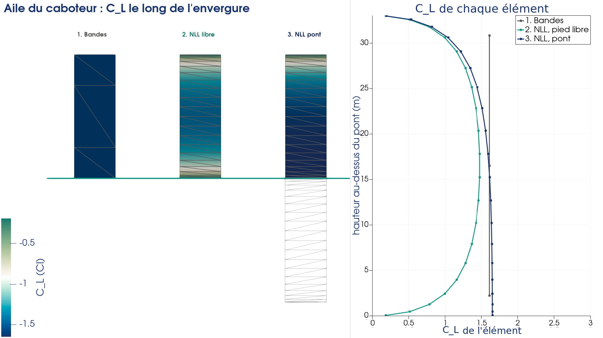

# TD 2 — De la théorie des bandes à la ligne portante · fiche élève

**EGN-S7 Propulsion assistée par le vent · séance de TD S2 · deux séances de 2 h (4 h).** Prérequis : le cours du 23/11,
deck S03 sur Vega (diapos 17 à 22 : passage à l'aile 3D ; 24 à 26 : modèles aérodynamiques ; 27 : Oceanbird ; 31 : efforts
dans le repère navire ; 33 et 34 : le caboteur d'école) ; le TD 1 (outil installé, vent du cas de l'aile du caboteur).

Les exercices sont tirés de la banque d'exercices d'EGN-S7 (A05 à A08, et A17). Chaque exercice porte son **niveau** :
**niveau 1**, application directe d'une définition ou d'une formule ; **niveau 2**, enchaînement de plusieurs étapes
ou lecture critique d'une source.

# Objectifs

À la fin de la séance, vous savez :

- calculer le facteur d'allongement d'une voile et dire ce qu'il fait perdre (A05, niveau 1) ;
- calculer à la main les efforts et la puissance de poussée de l'aile du caboteur (TD 1), et dire pourquoi cette puissance
  n'est pas l'économie au moteur (A06, niveau 2) ;
- dire ce que la théorie des bandes ne corrige pas, et le mesurer en relançant le cas de l'aile du caboteur en ligne portante non
  linéaire (NLL) (A06, niveau 2) ;
- mesurer l'effet du pont (plan de symétrie : le pont fait miroir), retrouver la traînée induite par la formule, et
  voir dans ParaView où l'aile perd sa portance le long de l'envergure (A06, niveau 2) ;
- trouver par balayage le réglage qui maximise la poussée, et reconnaître un résultat qui sort du domaine de la table
  de profil (A07, niveau 2) ;
- expliquer pourquoi le nombre d'éléments ne change rien en théorie des bandes et compte en NLL (A08, niveau 1) ;
- situer l'aile du caboteur par rapport à une aile réelle, la Wing 560 d'Oceanbird, et dire ce que vos résultats en
  disent et ce qu'ils n'en disent pas (A17, niveaux 1 et 2).

# Vos armes : les formules utiles (deck S03, diapos 17 à 31)

**Passage à l'aile 3D** (deck S03, diapos 18 à 20). Pour une aile d'allongement $`\mathrm{AR} = H^{2} / A`$ (hauteur au carré sur surface) :

- $`C_{L} \approx \frac{\mathrm{AR}}{2 + \mathrm{AR}} \, C_{L,2D}`$ ;
- $`C_{D} \approx C_{D,2D} + \frac{C_{L}^{2}}{e_{0} \pi \mathrm{AR}}`$, où le second terme est la traînée induite ($`e_{0}`$ : coefficient d'Oswald).

**Efforts dans le repère navire** (deck S03, diapo 31), avec les valeurs absolues de C_L et d'AWA :

- $`C_{x} = |C_{L}| \sin\,\mathrm{AWA} - C_{D} \cos\,\mathrm{AWA}`$ (poussée, vers l'avant) ;
- $`C_{y} = |C_{L}| \cos\,\mathrm{AWA} + C_{D} \sin\,\mathrm{AWA}`$ (force latérale) ;
- $`q = \frac{1}{2} \rho_{air} \mathrm{AWS}^{2}`$, $`F_{x} = C_{x} \, q \, A`$, $`F_{y} = C_{y} \, q \, A`$ ;
- puissance de poussée $`P_{x} = F_{x} \cdot u`$, où u est la vitesse du navire.

**Les modèles** (deck S03, diapos 25 et 26). En théorie des bandes, chaque bande est un profil 2D infini, sans interaction avec les
autres. En ligne portante non linéaire (NLL), les bandes interagissent par les vitesses induites de leurs
tourbillons : l'incidence effective de chaque bande est réduite.

**Données du cas de l'aile du caboteur** (fichier `aile-caboteur.yml`, TD 1) : $`\rho_{air} = 1{,}225`$ kg/m³ ; aile de 33 m de haut, AR = 3, pied posé sur le pont (z = −2,5 m, sommet à z = −35,5 m) ;
vent vrai 10,288 m/s, navire à 7,2016 m/s ; AWS = 12,558 m/s, AWA = 55,01° ; réglage 34,4°.

# Matériel

- **Ubuntu sous Windows (WSL)** et **CN-AeroModels v0.5.1** (binaire Linux), installés au TD 1 (sinon :
  `docs/00_PRE-VOL_Installation.md` du dépôt du TD, puis `python3 scripts/verifie_mon_install.py`).
- **Le dépôt du TD**, `~/TD-Propulsion-Velique` (à mettre à jour : `git pull`) : dossiers `cas/aile-caboteur/`,
  `cas/aile-caboteur/TD2_envergure/` et `cas/exemples/1- 2D model/`.
- **ParaView pour Windows**, installé au TD 1 (manipulation 3 du TD 1).
- Un éditeur de texte (pour modifier une copie du fichier `.yml`), un tableur ou Python pour le tracé d'A07, une
  calculatrice.

**Règle pour toutes les manipulations** : ne modifiez jamais le fichier d'origine. Copiez-le d'abord (par exemple
`cp aile-caboteur.yml essai.yml`), modifiez la copie, et lancez l'outil sur la copie, dans
le dossier du cas. Chaque lancement **écrase** `results.csv` : renommez-le avant de relancer s'il faut le garder.

# Manipulations pas à pas

Le TD se fait en **deux séances de 2 h** :

- **séance 1** : manipulations 1 à 4, avec A05, A06 et les questions P1 et P2 ;
- **séance 2** : l'encadré « De l'aile du caboteur à la Wing 560 » et l'exercice A17, puis les manipulations 5 et 6,
  avec A07 et A08, la question d'interprétation et, s'il reste du temps, les variantes.

Gardez d'une séance à l'autre vos fichiers `nll.yml` et `pont.yml` et les valeurs notées : la séance 2 s'en sert.

## Séance 1 — manipulations 1 à 4

## Manipulation 1 — Relancer le cas de l'aile du caboteur (pour A06)

> **Rappels du TD 1.** Pour ouvrir depuis Windows un fichier du dépôt (éditeur, tableur, ParaView), ne **retapez
> jamais** le chemin : dans le terminal Ubuntu, placez-vous dans le dossier voulu, tapez `wslpath -w .`, puis copiez
> l'adresse affichée (sélection à la souris, **Ctrl+Maj+C**) et collez-la. Un chemin retapé se trompe facilement d'une
> majuscule, et Linux distingue `aile-caboteur` de `Aile-caboteur` : le fichier est alors « introuvable ». Dans ParaView, à
> *Load State*, le *Data Directory* est le **dossier du cas** (il se termine par `aile-caboteur`).

```bash
cd ~/TD-Propulsion-Velique/cas/aile-caboteur
CN-AeroModels aile-caboteur.yml
```

**Auto-contrôle (valeur de référence : sortie de l'outil v0.5.1 ; mêmes forces que le tutoriel 1 de la formation du LHEEA (deck S03, diapos 39 et 40) ; moments différents, l'aile étant posée sur le pont)** : à l'écran, **F_x = 45 015,9 N** et
**F_y = 34 203,7 N**. Comparez ensuite les colonnes `CL`, `CD`, `Cx` et `Cy` à vos calculs d'A06, question 1 (valeurs
absolues).

## Manipulation 2 — Le cas de l'aile du caboteur en ligne portante non linéaire (pour A06, question 3)

Dans `aile-caboteur/`, copiez `aile-caboteur.yml` en `nll.yml`, puis, dans `nll.yml` :

1. remplacez la ligne `        model: strip theory` par les trois lignes suivantes (même indentation que la ligne
   remplacée, puis quatre espaces de plus) :

   ```yaml
           model: nonlinear lifting line
           options:
               useAWSsquare: false
               verbose: false
   ```

2. remplacez `number of elements: 3` par `number of elements: 10`.

Les deux options viennent de la formation du LHEEA. `useAWSsquare` choisit la vitesse qui entre dans l'équation de la
portance de chaque élément : la vitesse locale, au droit de l'élément (vent apparent et vitesses induites), ou la vitesse
amont (le vent apparent AWS). On garde `false`, la valeur de l'exemple de la formation ; sur ce cas, `true` ne change
F_x que de 1 %. `verbose: false` n'affiche que le résultat ; `true` ajoute le détail du calcul.

Lancez :

```bash
CN-AeroModels nll.yml
```

Notez F_x et F_y de la ligne `Total`, C_L et C_D de la ligne de l'aile `WPU-1` (la ligne juste au-dessus de `Total`,
qui les laisse en `N/A`). L'incidence **effective** n'est pas à l'écran (la colonne `AoA/SR` de l'écran garde
l'incidence géométrique, −20,61°) : lisez la moyenne dans `results.csv`, colonne `AoA`, et l'incidence de chaque
élément dans `aile-caboteur_WPU-1_0000.csv`, colonne `AoA(degrees)/SR` (une ligne par élément, du pied au sommet ;
ce fichier est écrasé à chaque lancement, comme `results.csv` : lisez-le avant de relancer).
Recommencez avec `number of elements: 20`.

**Auto-contrôle** : l'outil doit rendre des efforts **non nuls**, et les F_x obtenus avec 10 et 20 éléments doivent
différer de **moins de 1 %** (`docs/00b_CA_NA_PAS_MARCHE.md` du dépôt du TD). Sinon, le calcul n'a pas convergé : revenez à 10 éléments et
vérifiez les deux remplacements.

## Manipulation 3 — Le pont en miroir (pour A06, question 3)

L'aile est posée sur le pont. Sur un vrai navire, l'air ne passe pas sous son pied : le pont bloque le tourbillon
du pied, comme le ferait un miroir. L'outil le représente par un **plan de symétrie** : il ajoute sous le pont l'image
de l'aile, et calcule les vitesses induites par les deux.

Dans `aile-caboteur/`, copiez `nll.yml` (à 20 éléments, fin de la manipulation 2) en `pont.yml`. Dans
`pont.yml`, sous la ligne `        control: commands`, insérez le bloc suivant, en alignant `plane of symmetry:` sur
`control:` (huit espaces) :

```yaml
        plane of symmetry:
            point:
                x: {value: 0., unit: m}
                y: {value: 0., unit: m}
                z: {value: -2.5, unit: m}
            normal vector:
                x: {value: 0., unit: m}
                y: {value: 0., unit: m}
                z: {value: -1., unit: m}
            frame: ship
```

Le plan passe par le **pied de l'aile**, z = −2,5 m (le pont ; z vers le bas, repère NED), pas par l'origine du cas
(la flottaison, z = 0). Vérifiez que `pont.yml` a toujours `number of elements: 20`, puis lancez :

```bash
CN-AeroModels pont.yml
```

**Auto-contrôle** : à l'écran, **F_x = 39 530 N** et **F_y = 34 037,8 N**. Des efforts nuls signalent un calcul non
convergé : avec le plan de symétrie, l'outil ne converge pas pour tous les nombres d'éléments (40 éléments, par
exemple) ; restez à 20. Un plan laissé à z = 0 donne F_x ≈ 34,1 kN : c'est faux, le plan n'est pas au pied.

## Manipulation 4 — Voir la portance le long de l'envergure (ParaView ; pour P1 et P2)

On compare dans ParaView les trois calculs de l'aile : théorie des bandes (manipulation 1), NLL pied libre et NLL pont
en miroir (manipulations 2 et 3). Les trois écrivent des fichiers **de même nom**, qui s'écrasent : un script les
lance l'un après l'autre dans un dossier à part, `cas/aile-caboteur/TD2_envergure/`, et renomme les sorties après chacun. Il lit vos
`aile-caboteur.yml`, `nll.yml` (20 éléments) et `pont.yml` dans le dossier du cas, sans les modifier.

1. **Lancer les trois calculs**, dans le terminal Ubuntu :

   ```bash
   cd ~/TD-Propulsion-Velique/cas/aile-caboteur/TD2_envergure
   bash lancer_les_trois.sh
   ```

   **Auto-contrôle** : le script affiche trois lignes, `1_bandes` (F_x = 45015.9 N), `2_nll-pied-libre`
   (F_x = 32136.3 N) et `3_nll-pont` (F_x = 39530 N), puis « Les trois calculs sont faits ». S'il s'arrête avant, il
   dit quel fichier manque ou n'est pas à 20 éléments.
2. **Afficher l'adresse Windows du dossier**, toujours dans le terminal : `wslpath -w .` ; copiez l'adresse affichée
   (sélection à la souris, **Ctrl+Maj+C**). Elle se termine par `cas\aile-caboteur\TD2_envergure`.
3. **Charger l'état dans ParaView pour Windows** : *File > Load State…* ; dans le champ *File name*, collez l'adresse,
   **Entrée**, sélectionnez `TD2_envergure.pvsm`, *OK*. Dans *Load State Options* : **Search files under specified
   directory** ; *Data Directory* : laissez la valeur proposée (elle se termine par `TD2_envergure`) ; *OK*.

**Ce que vous devez voir** : un onglet *Envergure* avec deux vues (figure 1). Un chargement réussi n'ouvre **aucune**
fenêtre *Output Messages*.

- À gauche, **les trois ailes** vues de face, côte à côte, posées sur **le pont** (trait vert, z = −2,5 m) : la
  théorie des bandes (3 bandes), la NLL pied libre (20 éléments) et la NLL pont en miroir (20 éléments), avec leurs
  noms courts au-dessus (« 1. Bandes », « 2. NLL libre », « 3. NLL pont »). Chaque
  élément a la couleur de son C_L (barre « C_L (Cl) », signe de l'outil : bleu foncé ≈ −1,6, blanc ≈ −1, vert ≈ −0,5).
  Sous l'aile 3, en fil gris, **l'aile image** que l'outil ajoute sous le pont.
- À droite, **une courbe par calcul** : |C_L| de chaque élément (axe horizontal) en fonction de sa hauteur au-dessus
  du pont (axe vertical). Un point par élément.



Si l'onglet ne montre que les textes, sans ailes, ou si *Output Messages* affiche `Could not open file`, ParaView n'a
pas trouvé les données : relancez l'étape 1, puis l'étape 3 en vérifiant le *Data Directory*.

Repli, sans l'interface (ParaView de WSL : `sudo apt install paraview`), depuis le dossier du dépôt :
`pvpython scripts/TD2_voir_envergure.py`.

**Deux questions d'observation** (deux ou trois lignes chacune, sans calcul) :

- **P1.** Où l'aile en NLL pied libre perd-elle sa portance ? Pourquoi la théorie des bandes ne voit-elle pas cette
  perte (deck S03, diapos 17 à 22) ?
- **P2.** Que change le pont en miroir au pied de l'aile ? Et au sommet ? Reliez-le aux F_x des trois calculs.

## Séance 2 — de l'aile du caboteur à la Wing 560, puis le réglage

> **De l'aile du caboteur à la Wing 560.** Le **caboteur d'école** est un navire fictif de 110 m, celui du cours de
> performances du navire (EGN-S9) : sa résistance à l'avancement est connue, ce qui permet de traduire la poussée de
> l'aile en puissance gagnée à l'hélice (deck S03, diapos 33 et 34). **Son aile** est la géométrie du tutoriel 1 de la
> formation du LHEEA (profil NACA0015, symétrique, un seul élément), posée sur le pont du caboteur : c'est un cas
> d'école, pas un produit. La **Wing 560** est l'aile que vend Oceanbird (coentreprise d'Alfa Laval et de Wallenius
> Lines) ; la première a été installée en juin 2026 sur le roulier Tirranna. Les images sont dans le deck S03,
> diapo 27.

| | Aile du caboteur (TD) | Wing 560 (Oceanbird) |
|---|---|---|
| Hauteur × corde | 33 m × 11 m | 40 m × 14 m (46 m avec sa fondation basculante) |
| Surface S | 363 m² | 560 m² |
| Allongement H²/S | 3,0 | 2,86 |
| Profil | NACA0015, symétrique, un élément | deux éléments : aile principale et volet, qui crée la cambrure |
| Navire | caboteur d'école, 110 m | Tirranna (Wallenius Wilhelmsen), roulier de 230 m |
| Gain affiché | −17,7 % de puissance à l'hélice, à 14 nœuds par vent de travers de 20 nœuds (calcul du cours, diapo 34) | « jusqu'à 10 % » de carburant sur des routes favorables, une aile sur un navire existant (chiffre du constructeur) |

Table: Tableau 1 — L'aile du caboteur et la Wing 560 (sources de la Wing 560 : theoceanbird.com, pages *Wing 560* et *Press*, communiqué du 02/07/2026)

### A17 — De l'aile du caboteur à la Wing 560 · niveaux 1 et 2

1. *(niveau 1)* Comparez les allongements des deux ailes. Les conclusions de la séance 1 (perte de portance aux bouts,
   effet du pont en miroir) valent-elles pour la Wing 560 ?
2. *(niveau 2)* Passage à l'échelle **à coefficients égaux** (même vent apparent que le cas, mêmes C_x et C_y) : à partir
   de vos F_x des manipulations 2 (20 éléments) et 3, estimez la poussée de la Wing 560 en NLL pied libre et en NLL pont
   en miroir. Qu'est-ce qui rend ce calcul approximatif ?
3. *(niveau 2)* Que change le volet ? Que le modèle du TD (un profil, une table, un élément) ne représente-t-il pas ?
4. *(niveau 2)* Pourquoi le −17,7 % du caboteur et le « jusqu'à 10 % » de la Wing 560 sur le Tirranna ne se
   comparent-ils pas ?

## Manipulation 5 — Balayer le réglage (pour A07)

Dans `aile-caboteur/`, copiez `aile-caboteur.yml` en `balayage.yml`. La ligne `setting`, à la fin du fichier, fixe le réglage :

```yaml
    setting: {unit: deg, values: [34.4, 34.4]}
```

Remplacez **les deux** valeurs 34.4 par le réglage voulu (par exemple `[40, 40]`), lancez
`CN-AeroModels balayage.yml`, notez F_x et F_y de la ligne `Total`, puis passez au réglage suivant. Le groupe se
partage les réglages de 0 à 80°, de 5° en 5°, et met les résultats en commun.

**Auto-contrôle** : avec `[34.4, 34.4]`, `balayage.yml` doit redonner exactement la sortie de la manipulation 1
(F_x = 45 015,9 N).

## Manipulation 6 — L'exemple 1 : une bande ou dix (pour A08)

```bash
cd ~/TD-Propulsion-Velique/cas/exemples/"1- 2D model"
CN-AeroModels 1_element.yml
CN-AeroModels 10_elements.yml
```

**Auto-contrôle (valeurs de l'énoncé d'A08, question 3)** : pour chacun des deux fichiers, à l'écran (ligne de la voile, au-dessus de `Total`),
**C_L = −0,9125**, **C_D = 0,01582**, **C_x = 0,9125**, **C_y = 0,01582**.

# Énoncés

Séance 1 : A05 et A06. Séance 2 : A17 (posé plus haut, après l'encadré), A07 et A08.

## A05 — Facteur d'allongement · niveau 1

Calculer $`\mathrm{AR} / (\mathrm{AR} + 2)`$ pour AR = 3, 4 et 7. Que perd une voile d'allongement 3 ?

## A06 — Efforts de l'aile du caboteur, et ce que la théorie des bandes ne corrige pas · niveau 2

**Objectif.** Refaire à la main le calcul de l'outil en théorie des bandes, et voir ce qu'il ne prend pas en compte.

Cas de l'aile du caboteur : profil NACA0015, hauteur 33 m, AR = 3, trois bandes, vent uniforme ; l'outil donne
C_L = −1,611 et C_D = 0,0629.

1. Calculer la surface, q, C_x, C_y, F_x, F_y et P_x = F_x · u. Puis faire la manipulation 1 et comparer.

2. Que représente ce P_x pour un moteur de 5 000 kW, et pourquoi n'est-ce **pas** l'économie au moteur ?
3. Le C_L de l'outil est celui de la table 2D (A04, TD 1). L'allongement de 3 a-t-il été pris en compte ? Que donnerait le
   facteur d'A05 ? Faire ensuite la manipulation 2 et comparer F_x, F_y et l'incidence des éléments à la théorie des
   bandes.

   Traînée induite : avec les sorties à 20 éléments (C_L et C_D de la ligne `WPU-1`), retrouver le C_D de la NLL par
   $`C_{D} \approx C_{D,2D} + C_{L}^{2} / (e_{0} \pi \mathrm{AR})`$, avec AR = 3 et $`e_{0} = 1`$. Prendre C_D,2D, le C_D du profil seul, dans
   `aile-caboteur_WPU-1_0000.csv` (colonne `Cd`), à l'élément dont l'incidence (`AoA(degrees)/SR`) est la plus
   proche de l'incidence effective moyenne (`results.csv`, colonne `AoA`). Quelle part du C_D est de la traînée
   induite ?

   Faire la manipulation 3 (pont en miroir) et comparer ses F_x et F_y à ceux du pied libre. Une aile réelle est
   posée sur le pont avec un jeu de quelques centimètres sous son pied : pourquoi ses efforts sont-ils entre ceux des
   deux calculs NLL ?

## A07 — Balayage du réglage · niveau 2

Dans les conditions du cas de l'aile du caboteur, faire varier le réglage μ de 0 à 80° (manipulation 5). Tracer F_x(μ) et F_y(μ).
Pour quel réglage la poussée est-elle maximale ? Est-ce celui de C_L,max ? Que vaut le gain par rapport au réglage de
34,4° du cas ?

Regardez aussi les colonnes `CL` et `CD` pour les petits réglages (μ ≤ 30°) : que remarquez-vous, et d'où cela
vient-il (A04, TD 1) ?

## A08 — Invariance par discrétisation · niveau 1

Exemple 1 du dépôt LHEEA (`exemples/1- 2D model/`, fichiers `1_element.yml` et `10_elements.yml`) : lancer avec 1 puis
10 éléments (manipulation 6).

1. Pourquoi C_L, C_D, C_x et C_y sont-ils identiques ?
2. Quel est l'intérêt d'augmenter le nombre d'éléments en NLL ou en ISILL ?
3. *(sans outil)* L'exemple 1 donne C_L = −0,9125, C_D = 0,01582, C_x = 0,9125, C_y = 0,01582. Quel angle de vent
   apparent ces quatre nombres impliquent-ils ?

# Variantes pour les groupes rapides

Facultatives : seulement si votre binôme a fini A05 à A08 et A17 avant la fin de la séance 2.

## V1 — Convergence de la NLL selon le nombre d'éléments

Reprenez `nll.yml` (manipulation 2, pied libre) et faites varier `number of elements` : 3, 5, 10, 20 et 40. Tracez
F_x en fonction du nombre d'éléments. À partir de combien d'éléments F_x ne bouge-t-il plus de plus de 0,1 % ? Où
vous arrêteriez-vous, et pourquoi ?

Remarque : pour certains nombres d'éléments (80 sur ce cas, mais aussi 30), l'outil ne converge pas et rend des
efforts nuls. C'est une limite du solveur, pas un résultat physique : ne retenez pas ces points.

## V2 — A09 : ligne portante, théorie des bandes et mesures (Graf 2014) · niveau 2

L'exemple 3 du dépôt de l'outil, `cas/exemples/3- 2014 Graf OENG/`, est une aile rectangulaire NACA0012 de
400 × 1 800 mm (AR = 4,5, Re = 128 000, 21 éléments), dont les coefficients ont été mesurés (Graf et al., 2014). Le
fichier pose un plan de symétrie au pied de l'aile (`root: embedded`), comme votre `pont.yml`. Les mesures
sont dans `data.csv` (séparateur `;`), colonnes « Experiments [Graf et al., 2014] » : incidence et C_L, puis
incidence et C_D.

**Manipulation.**

```bash
cd ~/TD-Propulsion-Velique/cas/exemples/"3- 2014 Graf OENG"
cp 2014_Graf_OENG.yml graf.yml
CN-AeroModels graf.yml
```

Dans ce fichier, l'incidence vaut 90° moins le réglage : la ligne `setting: {unit: deg, values: [78., 78.]}`, à la
fin du fichier, donne une incidence de 12°. Pour 8°, remplacez les deux valeurs 78. par 82. Pour la théorie des
bandes, remplacez `model: nonlinear lifting line` par `model: strip theory`. Notez C_L et C_D sur la ligne de
l'aile (au-dessus de `Total`), en valeur absolue.

**Auto-contrôle** : des efforts non nuls, et un réglage affiché de 78 (12°) ou 82 (8°).

**Question.** Lancer la NLL, puis repasser en théorie des bandes ; comparer C_L et C_D à la mesure (`data.csv`) à 8° et à
12°. Quel modèle suit la mesure, et à quelle incidence l'accord se dégrade-t-il ?

# Question d'interprétation physique

En passant de la théorie des bandes à la NLL (manipulation 2), F_x et F_y ne baissent pas dans la même proportion.
Lequel des deux baisse le plus ? En vous aidant de la colonne `AoA/SR` (incidence de chaque élément) et des formules
de C_x et C_y, expliquez pourquoi l'incidence induite par les tourbillons pénalise surtout la poussée. Qu'en
concluez-vous sur l'usage de la théorie des bandes pour estimer le gain de puissance d'un navire ?

# Ce qu'il faut rendre

Un compte rendu (une à deux pages), selon les consignes de dépôt données par l'enseignant, avec :

1. les réponses d'A05, A06, A07, A08 et A17, **calculs posés** et unités ;
2. le tracé F_x(μ) et F_y(μ) d'A07 (tableur ou Python), avec le réglage de poussée maximale ;
3. le tableau des sorties des manipulations 2 et 3 (10 et 20 éléments, pont en miroir : F_x, F_y, C_L, C_D), le
   calcul de la traînée induite et votre comparaison avec la théorie des bandes ; ou, si l'outil n'a pas pu tourner,
   la panne rencontrée et le message d'erreur ;
4. vos réponses à P1 et P2 (manipulation 4), avec une capture de la vue si vous le pouvez ;
5. votre réponse à la question d'interprétation, en cinq lignes au plus.

# Sources

- LHEEA (Centrale Nantes / CNRS), support de formation *CN-AeroModels Training* (LH), p. 21-27 ; ligne portante non
  linéaire, plan de symétrie et options, p. 31-45.

- CN-AeroModels v0.5.1, A. Babarit et M. Charlou, LHEEA, <https://gitlab.com/lheea/CN-AeroModels> (EPL 2.0) ; fichiers
  `airfoil_data/NACA0015_v2.yml`, exemple 1 (`1_element.yml`, `10_elements.yml`).
- ParaView (Kitware, licence BSD) ; état `cas/aile-caboteur/TD2_envergure/TD2_envergure.pvsm`, script `cas/aile-caboteur/TD2_envergure/lancer_les_trois.sh`
  et repli `scripts/TD2_voir_envergure.py` (ENSM).
- Cas de l'aile du caboteur, `cas/aile-caboteur/aile-caboteur.yml` (ENSM, construit sur l'exemple 1) ;
  mêmes forces que le tutoriel 1 de la formation du LHEEA ; moments différents, l'aile étant posée sur le pont.
- Support d'exercices CN-AeroModels de l'ENSM : document interne, non distribué ; les valeurs d'A08, question 3 en
  viennent (ce sont celles de l'exemple 1).

- Cours EGN-S7 du 23/11, deck S03 « Aérodynamique et passage au TD » (Vega), diapos 17 à 31.
- Banque d'exercices EGN-S7, exercices A05 à A08, A17 et A09 (variante) ; dépôt public du TD, `TD-Propulsion-Velique`.
- Oceanbird, <https://www.theoceanbird.com/wing-560> (dimensions : « 46 meters tall from the foundation to the top. The
  wing itself is 40 meters and 14 meters wide ») et communiqué du 02/07/2026, <https://www.theoceanbird.com/press>
  (installation sur le Tirranna, « up 10% of fuel and emissions on optimal routes ») ; pages consultées le 25/11/2026.
- Graf et al. (2014), mesures sur l'aile NACA0012 de l'exemple 3 de CN-AeroModels, tels que les reprend
  le fichier `data.csv` de l'exemple (dépôt de l'outil, EPL 2.0).
