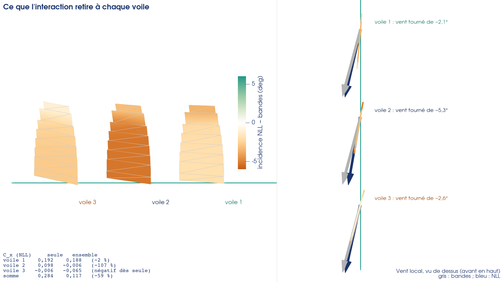

# TD 3 — Le rotor, et quand les unités se gênent · fiche élève

**EGN-S7 Propulsion assistée par le vent · séance de TD S3 · durée 2 h.** Prérequis : le cours du 23/11, deck S03 sur
Vega (diapos 9 et 10 : incidence, réglage et vent apparent ; 19 et 26 : les tourbillons et la ligne portante ;
28 et 29 : des ailes qui se gênent ; 31 : efforts dans le repère navire) ; le cours sur les technologies du marché,
dont les rotors (Vega) ; les TD 1 et 2 (outil installé, cas de l'aile du caboteur, théorie des bandes et NLL).

**Deux familles physiques.** Une aile tire sa force de la **portance d'un profil** : c'est l'aile rigide des TD 1 et
2, et c'est aussi le DynaRig, dont les voiles carrées forment un profil courbe. Un rotor Flettner tire la sienne de
l'**effet Magnus** : un cylindre qui tourne dans le vent dévie l'écoulement et porte, sans profil ni incidence. Le TD
compare d'abord un rotor seul à l'aile du caboteur, puis montre que plusieurs unités sur un même pont se gênent.

Les exercices sont tirés de la banque d'exercices d'EGN-S7 (A11, A12, A14, A15). Chaque exercice porte son
**niveau** : **niveau 1**, application directe d'une définition ou d'une formule ; **niveau 2**, enchaînement de
plusieurs étapes ou lecture critique d'une source. Chaque question porte aussi sa **place** : *en séance*, *au compte
rendu* (traitée hors séance, rendue avec le compte rendu) ou *variante* (groupes rapides).

# Objectifs

À la fin de la séance, vous savez :

- établir C_L = 2π SR pour un cylindre tournant en écoulement potentiel, et dire pourquoi un rotor réel en est loin
  (A11, niveau 1) ;
- dire ce que font les **plaques d'extrémité** d'un rotor, et reconnaître un calcul qui n'a pas convergé (A11,
  manipulations 2 et 3) ;
- passer du **taux de rotation** SR à la vitesse de rotation, calculer la poussée, la force latérale, la **puissance
  consommée** et la **puissance nette** d'un rotor, et les comparer à celles de l'aile du caboteur (A12, niveau 2) ;
- reconnaître un cas où le rotor ne voit presque pas de vent, et ce qu'un optimiseur de puissance nette en fait (A14,
  niveau 1) ;
- dire d'où viennent les interactions entre unités véliques et comment on les modélise (A15, niveau 2) ;
- **isoler l'interaction** sur trois ailes alignées au près : chaque voile calculée seule, puis les trois ensemble, en
  NLL, à côté de la théorie des bandes ; dire ce que perd la voile aval (manipulations 4 à 6).

# Vos armes : les formules utiles

**Rotor Flettner** (cours sur les technologies, Vega). Pour un rotor de diamètre D = 2R, de hauteur H, tournant à Ω
(rad/s) dans un vent apparent AWS :

- taux de rotation (*spin ratio*) $`\mathrm{SR} = \frac{\Omega R}{\mathrm{AWS}}`$, d'où $`\Omega = \frac{\mathrm{SR} \cdot \mathrm{AWS}}{R}`$, et $`N = \frac{60 \, \Omega}{2 \pi}`$ en tr/min ;
- surface de référence $`A = H D`$ ; $`q = \frac{1}{2} \rho_{air} \mathrm{AWS}^{2}`$ ; portance $`L = C_{L} \, q \, A`$, traînée $`D_{r} = C_{D} \, q \, A`$ ;
- dans le repère navire (deck S03, diapo 31) : $`F_{x} = L \sin\,\mathrm{AWA} - D_{r} \cos\,\mathrm{AWA}`$, $`F_{y} = L \cos\,\mathrm{AWA} + D_{r} \sin\,\mathrm{AWA}`$ ;
- puissance consommée par la rotation $`P_{c} = \frac{1}{2} \rho_{air} \, H D \, W^{3} \, C_{p}(\mathrm{SR})`$, où W est la vitesse du vent et
  $`C_{p}`$ le coefficient de puissance du rotor ;
- puissance nette de propulsion $`P_{net} = F_{x} \, u - P_{c}`$, où u est la vitesse du navire.

**Vent apparent** (deck S03, diapo 10 ; TD 1) : $`\mathrm{AWS}^{2} = \mathrm{TWS}^{2} + \mathrm{BS}^{2} + 2 \, \mathrm{TWS} \, \mathrm{BS} \cos\,\mathrm{TWA}`$ ;
$`\tan\,\mathrm{AWA} = \frac{\mathrm{TWS} \sin\,\mathrm{TWA}}{\mathrm{TWS} \cos\,\mathrm{TWA} + \mathrm{BS}}`$. Convention de l'outil (deck S03, diapo 12) : la direction du fichier est celle
**vers** laquelle souffle le vent.

**Interactions** (deck S03, diapos 28 et 29). Une unité placée sous le vent d'une autre voit un vent modifié : d'abord
les vitesses induites par les tourbillons des unités amont (la NLL les calcule), puis le sillage visqueux (la NLL ne le
calcule pas).

**Données du cas de l'aile du caboteur** (TD 1 et 2) : $`\rho_{air} = 1{,}225`$ kg/m³ ; AWS = 12,558 m/s ; AWA = 55,01° ; navire
à u = 7,2016 m/s. Aile du caboteur en théorie des bandes (TD 2, manipulation 1) : 363 m², F_x = 45,0 kN, F_y = 34,2 kN.

# Matériel

- **Ubuntu sous Windows (WSL)** et **CN-AeroModels v0.5.1** (binaire Linux), installés au TD 1.
- **Le dépôt du TD**, `~/TD-Propulsion-Velique`, à mettre à jour (`git pull`) : tout le TD 3 est dans le dossier
  `TD3_rotor-et-interactions/`, un sous-dossier par manipulation (tableau ci-dessous).
- **ParaView pour Windows**, installé au TD 1.
- Un éditeur de texte, une calculatrice.

| Manipulation | Dossier (dans `~/TD-Propulsion-Velique/TD3_rotor-et-interactions/`) | Commande |
|---|---|---|
| 1 — rotor sans vent (exemple 19) | `manip1_rotor-sans-vent/` | `bash lancer.sh 35x5_flettner.yml` |
| 2 et 3 — rotor avec et sans plaques (exemple 7) | `manip2-et-3_rotor-plaques/` | `bash lancer.sh 2008_Badalamenti.yml`, puis `bash lancer.sh sans-plaques.yml` |
| 4 à 6 — trois ailes au près (exemple 9, cas à 15°) | `manip4-a-6_trois-ailes-15deg/` | `bash lancer.sh` (après la copie `bandes.yml`) |
| Variante — le fichier de l'exemple 9 tel que fourni | `variante_trois-ailes-fichier-LHEEA/` | `bash lancer.sh trois-ailes.yml` |
| Variante V-DynaRig — régler le mât arrière | `variante_dynarig-reglage-mat-arriere/` | `bash lancer.sh -75` (un réglage par calcul) |
| Démonstration de l'enseignant — deux DynaRigs ; fardage (compte rendu) | `demo_dynarig-greenpeace/` | `bash lancer.sh` ; `python3 fardage.py` |

Table: Tableau 1 — Où travailler : un dossier par manipulation

Chaque dossier contient ce que sa manipulation demande : le fichier d'entrée (`.yml`), le script `lancer.sh` et, pour
les manipulations 4 à 6, l'état ParaView `vue.pvsm`. **Les sorties de calcul vont dans le sous-dossier `sorties/`**
du dossier : `lancer.sh` lance l'outil, affiche tout ce qu'il écrit à l'écran et range ses fichiers dans `sorties/`
(`<fichier>_results.csv` ; la sortie écran dans `<fichier>_ecran.txt`, pour y chercher un message).

**Règle pour toutes les manipulations** (comme au TD 2) : ne modifiez jamais un fichier fourni ; copiez-le, modifiez
la copie et lancez l'outil sur la copie, dans le dossier de la manipulation.

> **Rappels des TD 1 et 2.** Pour ouvrir depuis Windows un fichier du dépôt (éditeur, tableur, ParaView), ne **retapez
> jamais** le chemin : dans le terminal Ubuntu, placez-vous dans le dossier voulu, tapez `wslpath -w .`, puis copiez
> l'adresse affichée (sélection à la souris, **Ctrl+Maj+C**) et collez-la. Linux distingue `trois-ailes` de
> `Trois-ailes` : un chemin retapé donne vite un fichier « introuvable ». Dans ParaView, à *Load State*, le *Data
> Directory* est le **dossier de la manipulation** (ici, il se termine par `manip4-a-6_trois-ailes-15deg`).

# Déroulé de la séance

- **Partie 1, le rotor Flettner** : A11, question 2, avec les manipulations 2 et 3 (exemple 7, avec et sans plaques
  d'extrémité) ; A12 (énoncé sur Vega) ; A14, puis la manipulation 1 (exemple 19).
- **Partie 2, quand les unités se gênent** : A15, question 1 ; manipulations 4 à 6 (trois ailes au près : chaque voile
  seule, puis les trois ensemble, en NLL et en théorie des bandes, puis dans ParaView), avec les questions T1 et T2 ;
  l'encadré « Ce que dit la mesure » ; une démonstration de l'enseignant (5 min).
- **Au compte rendu** : A11, question 1 (travail personnel), A15, question 3, la question d'interprétation, et la
  synthèse aile ou rotor, qui reprend vos valeurs d'A12.

# Partie 1 — Le rotor Flettner

## Manipulation 1 — Exemple 19 : un rotor piloté en puissance nette (après A14)

Faites d'abord A14 à la main, puis :

```bash
cd ~/TD-Propulsion-Velique/TD3_rotor-et-interactions/manip1_rotor-sans-vent
bash lancer.sh 35x5_flettner.yml
```

`35x5_flettner.yml` est une copie à l'identique de l'exemple 19 du LHEEA. Le calcul dure quelques secondes. Le fichier
pilote le rotor en `maxThrustPower` : l'outil choisit lui-même la vitesse de rotation qui maximise la puissance nette,
en partant de 100 tr/min (dernière ligne du fichier). Des centaines de lignes `Warning … out of range` défilent : lisez-en
une, puis allez au tableau `Results`, à la fin.

**Auto-contrôle** : une ligne `rotor_1` et une ligne `Total` s'affichent ; les colonnes `AWS` et `AWA` doivent
redonner **vos valeurs d'A14** (valeur absolue). La colonne `setting` donne la vitesse de rotation retenue (tr/min),
la colonne `AoA/SR` le taux de rotation ; `sorties/35x5_flettner_results.csv` donne en plus `Px(kW)`.

## Manipulation 2 — Exemple 7 : le rotor de Badalamenti et Prince, avec ses plaques (pour A11)

```bash
cd ~/TD-Propulsion-Velique/TD3_rotor-et-interactions/manip2-et-3_rotor-plaques
bash lancer.sh 2008_Badalamenti.yml
```

`2008_Badalamenti.yml` et `data.csv` sont des copies à l'identique de l'exemple 7 du LHEEA. Rotor de soufflerie de
88 mm de diamètre et 450 mm de haut, vent de 3 m/s, tournant à 2 273 tr/min, calculé en NLL. Ouvrez
`2008_Badalamenti.yml` dans l'éditeur et repérez comment le fichier représente les **plaques d'extrémité** : les deux
lignes `root: end plate` et `tip: end plate` (rubrique `end conditions`), et l'option `endPlateCoefficient: 0.5`
(rubrique `options`).

**Auto-contrôle** : à l'écran, la colonne `setting` vaut **2273** (tr/min, dernière ligne du fichier) et la colonne
`AoA/SR` vaut **3.5**. Relevez C_L et C_D, et la dernière ligne `iteration : … % variation` au-dessus du tableau
`Results` (l'écart entre les deux dernières itérations du calcul).

## Manipulation 3 — Le même rotor sans plaques (pour A11)

Dans le même dossier, copiez `2008_Badalamenti.yml` en `sans-plaques.yml`, puis, dans `sans-plaques.yml`, remplacez
`root: end plate` par `root: free` et `tip: end plate` par `tip: free` (rien d'autre). Lancez :

```bash
bash lancer.sh sans-plaques.yml
grep "Newton method has failed" sorties/sans-plaques_ecran.txt
```

Relevez C_L et C_D, le message `Newton method has failed` (la seconde commande l'affiche s'il est dans la sortie), et la
dernière ligne `iteration : … % variation`. Recommencez avec `number of elements: 15` au lieu de 25 dans
`sans-plaques.yml`.

**Auto-contrôle** : `setting` = 2273 et `AoA/SR` = 3.5, comme à la manipulation 2. Comparez ensuite, à SR = 3,5, vos
C_L aux mesures de Badalamenti et Prince jointes à l'exemple, dans `data.csv` (séparateur `;`) : colonnes 1 et 2 pour le
rotor **sans plaques** (`[no end plates]`, SR puis C_L), colonnes 8 et 9 pour le rotor **avec plaques** (`[end plates
2D]`, SR puis C_L).

## A11 — C_L = 2π SR · niveau 1

1. *(au compte rendu, travail personnel)* Montrer que C_L = 2π SR en écoulement potentiel autour d'un cylindre
   tournant (circulation $`\Gamma = 2 \pi R \cdot \Omega R`$, portance linéique $`L' = \rho V \Gamma`$). Que vaut 2π SR à SR = 2 ? Comparer aux C_L
   mesurés à SR = 2 (`data.csv` de l'exemple 7, avec et sans plaques).
2. *(en séance)* Avec les manipulations 2 et 3 : que vaut 2π SR au taux de rotation de l'exemple 7 ? Que donne l'outil
   avec les plaques, et que donne la mesure ? Sans les plaques, le calcul de l'outil a-t-il convergé, et peut-on
   retenir son C_L ? Que font les plaques d'extrémité sur un rotor ?

## A12 — Rotor 35 × 5 m dans le vent du cas de l'aile du caboteur · niveau 2

*(en séance)* **Énoncé sur Vega** : il s'appuie sur des courbes d'un support de formation non libre, qui ne sont pas
reproduites dans ce dépôt public. Vous y passez du taux de rotation à la vitesse de rotation, puis calculez F_x, F_y,
la puissance consommée et la puissance nette d'un rotor de 35 m × 5 m, pour SR = 1, 2 et 3, et comparez à l'aile du
caboteur. **Gardez vos valeurs : vous les reprendrez dans la synthèse du compte rendu** (aile ou rotor).

## A14 — L'exemple 19 : un rotor sans vent · niveau 1

*(en séance)* Exemple 19 du dépôt LHEEA : vent de 7,5 m/s de direction −5° (NED), navire à 15 nœuds cap nord. Calculer
AWS et AWA, puis commenter. Faire ensuite la manipulation 1 : quelle vitesse de rotation l'outil retient-il, à quel
taux de rotation, et quelle poussée le rotor donne-t-il ? Est-ce cohérent avec votre commentaire ? Le taux de rotation
retenu est-il dans la table du rotor (lisez un des avertissements) ?

# Partie 2 — Quand les unités se gênent

## A15 — Interactions entre voiles · niveau 2

1. *(en séance)* D'où viennent les pertes des unités sous le vent ? Dans quel ordre les modélise-t-on ?
2. *(variante)* Avec les trois ailes au près (manipulations 4 à 6) : tracer C_x voile par voile en NLL, en théorie des
   bandes, puis en ISILL. Pour l'ISILL, copiez `trois-ailes-15deg.yml` en `isill.yml` et remplacez la ligne du modèle
   par `      - model: ISILL` ; faites de même pour chaque `voile-N-seule.yml` ; lancez chaque copie depuis
   `sorties/` (`cd sorties`, puis `CN-AeroModels ../isill.yml`). L'ISILL donne-t-elle la même perte que la NLL ?
3. *(au compte rendu)* Pour quatre voiles alignées, estimer la réduction de poussée par rapport à quatre voiles
   isolées. Quelle source le permet ?

## Manipulation 4 — Trois ailes de Malmek au près, les trois ensemble en NLL

Le dossier `manip4-a-6_trois-ailes-15deg/` contient `trois-ailes-15deg.yml` : trois ailes de type Oceanbird à l'échelle
de la soufflerie (1,385 m de haut), alignées le long de l'axe x, l'aile 1 à l'avant, dans un vent de 25 m/s qui arrive
à 15° de l'avant, navire à l'arrêt. C'est une **copie de l'exemple 9 du LHEEA** (`2023_Malmek_3sails.yml`) dont seuls
les trois réglages changent : ce sont ceux du cas « vent apparent à 15° » du tutoriel du LHEEA, validé contre la
soufflerie de Malmek (2023). Le fichier pose un plan de symétrie au pied des ailes (le plafond de la soufflerie, comme
le pont du TD 2). Le dossier contient aussi `voile-1-seule.yml`, `voile-2-seule.yml` et `voile-3-seule.yml` : le même
fichier avec **une seule voile**, à la même place et au même réglage. Lancez d'abord les trois voiles ensemble :

```bash
cd ~/TD-Propulsion-Velique/TD3_rotor-et-interactions/manip4-a-6_trois-ailes-15deg
mkdir -p sorties && cd sorties && CN-AeroModels ../trois-ailes-15deg.yml; cd ..
```

Relevez, pour chaque voile (`sail_1`, `sail_2`, `sail_3`), `AoA/SR`, C_L, C_x et C_y à l'écran ;
`sorties/results.csv` donne en plus, colonne `AoA`, l'incidence effective de chaque voile (une ligne par voile).

**Auto-contrôle** : trois lignes `sail_1` à `sail_3`, avec **AWS = 25** et **AWA = 15**, et les réglages **−5, −10
et −15** (colonne `setting`) ; ce sont les données du fichier.

## Manipulation 5 — Le même cas en théorie des bandes

Dans `manip4-a-6_trois-ailes-15deg/`, copiez `trois-ailes-15deg.yml` en `bandes.yml` ; dans `bandes.yml`, remplacez la
ligne `      - model: nonlinear lifting line` par `      - model: strip theory` (même indentation, rien d'autre),
puis :

```bash
cd sorties && CN-AeroModels ../bandes.yml; cd ..
```

Relevez les mêmes colonnes. **Auto-contrôle** : mêmes AWS, AWA et réglages qu'à la manipulation 4 ; à l'écran, dans
les deux modèles, la colonne `AoA/SR` de chaque voile vaut son réglage corrigé de l'AWA (réglage + 15 : 10, 5 et 0,
l'incidence géométrique) ; l'incidence effective est dans `sorties/results.csv`, colonne `AoA` (en bandes, elle est
égale à l'incidence géométrique ; en NLL, elle tient compte des tourbillons de toutes les voiles).

## Manipulation 6 — Chaque voile seule, et voir les trois ailes (ParaView ; pour T1 et T2)

1. **Lancer tous les calculs avec les sorties ParaView**, dans le terminal Ubuntu :

   ```bash
   cd ~/TD-Propulsion-Velique/TD3_rotor-et-interactions/manip4-a-6_trois-ailes-15deg
   bash lancer.sh
   ```

   Le script lance `bandes.yml`, puis `trois-ailes-15deg.yml` (NLL), puis chaque `voile-N-seule.yml` (NLL), range les
   sorties dans `sorties/` (`bandes_*`, `nll_*`, `nll-seule_*`) et affiche, voile par voile, l'incidence, C_L, C_x et
   C_y, puis la somme des C_x des trois voiles ensemble et des trois voiles seules. **Auto-contrôle** : trois blocs de
   trois lignes, la ligne « Somme des C_x », puis « Les calculs sont faits ». S'il s'arrête avant, il dit quel fichier
   manque ou en quoi `bandes.yml` diffère de `trois-ailes-15deg.yml`.
2. **Afficher l'adresse Windows du dossier** : `wslpath -w .` ; copiez l'adresse (**Ctrl+Maj+C**). Elle se termine
   par `TD3_rotor-et-interactions\manip4-a-6_trois-ailes-15deg`.
3. **Charger l'état dans ParaView pour Windows** : *File > Load State…* ; dans *File name*, collez l'adresse,
   **Entrée**, sélectionnez `vue.pvsm`, *OK*. Dans *Load State Options* : **Search files under specified directory** ;
   *Data Directory* : laissez la valeur proposée (elle se termine par `manip4-a-6_trois-ailes-15deg`) ; *OK*.

**Ce que vous devez voir** : deux onglets, *Interaction* et *Bandes et NLL*, chacun avec deux vues ; cliquez sur
l'onglet *Interaction* s'il n'est pas devant (figure 1). Un chargement réussi n'ouvre **aucune** fenêtre *Output Messages*.

Onglet *Interaction* (pour T1 et T2) :

- À gauche, les trois voiles (NLL) **vues en plongée, du côté d'où vient le vent**, l'avant du navire à droite, sur
  l'axe du navire (trait vert). **La couleur est l'interaction** : l'écart d'incidence de chaque élément entre la NLL
  et la théorie des bandes (barre « incidence NLL − bandes (deg) », centrée sur 0 : blanc, rien n'a changé ; orange,
  l'élément a perdu de l'incidence). Les réglages, différents d'une voile à l'autre, n'y sont plus : ici, **on peut
  comparer les voiles entre elles**. En bas, le **bilan chiffré** : le C_x de chaque voile seule et ensemble (NLL), et
  la perte.
- À droite, la **vue de dessus**, l'avant en haut : à mi-hauteur de chaque voile, au quart de corde, le **vent apparent
  local** que voit l'élément (colonnes `ApparentVelocity` des sorties par élément de l'outil, vitesses induites
  comprises), en théorie des bandes (flèche grise : la même pour les trois voiles) et en NLL (flèche bleue : elle tourne
  de voile en voile), avec l'angle dont il a tourné. Les voiles sont vues par la tranche.

Onglet *Bandes et NLL* (la vue des sessions précédentes) : à gauche, les trois ailes deux fois, « 1. Bandes » en haut,
« 2. NLL » en bas, chaque élément à la couleur de son C_L (barre « C_L (Cl) », signe de l'outil), le **vent apparent**
(flèche orange, à 15° de l'avant) et les tourbillons en fer à cheval de la NLL (traits gris) ; à droite, **l'incidence
de chaque élément** en fonction de sa hauteur, avec le signe de l'outil (colonne `AoA` de `results.csv`) : une couleur
par voile, trait plein pour la NLL, tirets pour la théorie des bandes. Dans cette vue, **comparez la même voile en haut
et en bas, pas les voiles entre elles** : les couleurs de la rangée « Bandes » diffèrent déjà par les réglages (−5,
−10 et −15°), pas par l'interaction.



Si l'onglet ne montre que les textes, ou si *Output Messages* affiche `Could not open file`, ParaView n'a pas trouvé
les données : relancez l'étape 1, puis l'étape 3 en vérifiant le *Data Directory*. Repli, sans l'interface (ParaView
de WSL), depuis le même dossier : `pvpython voir_sans-paraview.py`.

**Deux questions d'observation** (deux ou trois lignes chacune) :

- **T1.** *(en séance)* Comparez, voile par voile, la NLL des trois voiles ensemble à la NLL de chaque voile seule
  (sortie de `lancer.sh`) : laquelle perd le plus ? De combien la somme des C_x baisse-t-elle, en pourcentage ? Lisez
  l'incidence effective des voiles 2 et 3 dans les deux calculs (colonne `AoA`, ou l'onglet *Interaction*) : que fait la
  voile 1 au vent que voient les voiles placées derrière elle ?
- **T2.** *(en séance)* Le signe de cette perte est-il celui que Bordogna mesure au près sur deux DynaRigs (encadré
  ci-dessous) ? La NLL calcule la déviation du vent par les tourbillons des voiles amont (flèches bleues de la vue de
  dessus, onglet *Interaction*) : quel effet sur la voile aval
  ne calcule-t-elle pas (A15, question 1), et la perte réelle serait-elle plus grande ou plus petite ? Vérifiez enfin
  que chaque voile travaille dans le domaine finement renseigné de sa table de profil : ouvrez `trois-ailes-15deg.yml`
  et lisez une ligne `AoA:` de la rubrique `foil data`, au Reynolds de 500 000 ou de 1 000 000 (le Reynolds de chaque
  élément est dans la colonne `Re` des fichiers `sorties/nll_voile-N_elements.csv`).

> **Ce que dit la mesure.** Le LHEEA valide la NLL contre la mesure sur ce cas de trois ailes alignées au près, à 15° du
> vent apparent (Malmek, 2023 ; deck S03, diapo 28), et deux ailes du caboteur l'une derrière l'autre perdent 2,8 % de
> poussée à 48 m d'écart (diapo 29). En soufflerie, sur deux voiles rigides (DynaRig), Bordogna (2020) trouve que
> l'interaction est **favorable aux deux voiles aux allures moyennes**, et **défavorable à la voile aval aux petits et
> aux grands angles** de vent apparent (au près et au vent arrière). Le signe de l'interaction dépend donc de l'allure :
> on ne pose pas « une perte sous le vent » en règle.

**Démonstration de l'enseignant (5 min)**, en fin de partie 2 : deux DynaRigs d'école sur un navire générique aux
dimensions publiées du navire de Greenpeace (dossier `demo_dynarig-greenpeace/`). Les dimensions publiées (longueur,
largeur, tirant d'eau, tirant d'air, surface de voilure) sont celles de l'armateur et de l'architecte ; tout le reste
(forme de la voilure, hauteurs, positions des mâts, vent) est une **hypothèse d'école**, écrite en tête de
`fabriquer_cas.py`. La section de voile est une **polaire d'école, hypothèse : aucune polaire de section de DynaRig
n'est publiée** (`fabriquer_polaire.py`). **Le calcul porte sur la ligne portante, le rendu montre le gréement** : dans
la vue, la surface plane colorée par C_L est celle du calcul ; la coque, les mâts, les six vergues courbes de chaque
mât et les voiles creuses sont un habillage construit par script, qui ne change aucun effort (ce qui est relevé et ce
qui est inventé : `README.md` du dossier).

## Variante — Le fichier de l'exemple 9 tel que fourni : une leçon de lecture

*(variante)* Le dossier `variante_trois-ailes-fichier-LHEEA/` contient `trois-ailes.yml`, copie à l'identique de
l'exemple 9 du LHEEA (`2023_Malmek_3sails.yml`) : même vent, mêmes ailes, mais d'autres réglages (−80, −75 et −70°).

```bash
cd ~/TD-Propulsion-Velique/TD3_rotor-et-interactions/variante_trois-ailes-fichier-LHEEA
bash lancer.sh trois-ailes.yml
```

- **T3.** Relevez l'incidence effective de chaque voile (`sorties/trois-ailes_results.csv`, colonne `AoA`, signe de
  l'outil) et comparez-la à la table de profil (même ligne `AoA:` qu'en T2). Que fait l'outil à ces incidences, et que
  valent alors les C_L (souvenez-vous d'A07, TD 2) ? Calculez chaque voile seule comme à la manipulation 6 (copiez
  `voile-N-seule.yml` de la manipulation 4 et remettez-y le réglage de ce fichier) : pourquoi ne lit-on dans ce
  fichier aucune interaction exploitable ?

## Variante V-DynaRig — Régler le mât arrière (groupes rapides)

*(variante)* Les deux DynaRigs d'école de la démonstration, au travers : mât avant fixe à −70°, réglage du mât arrière
au choix. Chaque commande `bash lancer.sh RÉGLAGE` fait un calcul NLL (40 éléments par mât, quelques secondes) et ajoute
une ligne à `sorties/balayage.csv` (réglage, incidences, F_x de chaque mât et F_x total ; séparateur `;`, décimales
avec un point : à préciser à l'import dans le tableur). Un calcul relancé ajoute une ligne de plus : effacez
`sorties/balayage.csv` avant de recommencer un balayage. Balayez de −90° à −50° par pas de 5° :

```bash
cd ~/TD-Propulsion-Velique/TD3_rotor-et-interactions/variante_dynarig-reglage-mat-arriere
for r in -90 -85 -80 -75 -70 -65 -60 -55 -50; do bash lancer.sh $r; done
```

- **V1.** Tracez F_x total en fonction du réglage du mât arrière (`sorties/balayage.csv`, dans un tableur). Quel
  réglage donne la plus grande poussée ? De combien (en kN et en %) dépasse-t-elle celle du mât arrière réglé
  comme le mât avant, à −70° ?
- **V2.** Au réglage égal, comparez l'incidence du mât arrière à celle du mât avant. Pourquoi le mât arrière ne se
  règle-t-il pas comme le mât avant ? (Souvenez-vous de T1 : ce que fait une voile au vent que voient les voiles
  placées derrière elle.)
- **V3.** Refaites le réglage optimal et le réglage égal avec 80 éléments par mât (`bash lancer.sh -55 80`,
  `bash lancer.sh -70 80`). Le calcul a-t-il convergé dans les deux cas (on le dit convergé si F_x total change de
  moins de 2 % de 40 à 80 éléments ; l'outil ne signale rien) ? Que retenez-vous de l'optimum trouvé ?

# Question d'interprétation physique

*(au compte rendu)* Vos manipulations 4 à 6 donnent trois calculs : la théorie des bandes, la NLL de chaque voile
seule et la NLL des trois voiles ensemble. Quel effet mesure l'écart entre les deux premiers, et quel effet l'écart
entre les deux derniers ? Pourquoi comparer seulement la théorie des bandes à la NLL des trois voiles ensemble ne
dirait-il rien de l'interaction seule ? À quelle condition sur l'incidence des voiles ces comparaisons ont-elles un
sens (variante, T3) ?

# Ce qu'il faut rendre

Un compte rendu (une à deux pages), selon les consignes de dépôt données par l'enseignant, avec :

1. les réponses d'A11 (la question 1 traitée en travail personnel), A12, A14 et A15 (question 1), **calculs posés** et
   unités ; pour A12, un tableau par SR ;
2. les sorties relevées des manipulations : vitesse de rotation, taux de rotation et efforts de l'exemple 19 ; C_L, C_D
   et convergence de l'exemple 7 avec et sans plaques, à côté de la mesure ; incidence, C_L, C_x et C_y par voile des
   trois ailes au près, en théorie des bandes, en NLL ensemble et en NLL voile seule ; ou, si l'outil n'a pas pu
   tourner, la panne rencontrée et le message d'erreur ;
3. vos réponses à T1 et T2 (manipulation 6), avec une capture de la vue si vous le pouvez ;
4. A15, question 3, et votre réponse à la question d'interprétation, en cinq lignes au plus ;
5. la **synthèse du TD, aile ou rotor** : la question de synthèse donnée par l'enseignant, qui reprend vos valeurs
   d'A12 (SR = 2 et 3) et celles de l'aile du caboteur (TD 2) ;
6. **le fardage du navire de la démonstration** : dans `demo_dynarig-greenpeace/`, lancez `python3 fardage.py` (méthode
   empirique de Fujiwara, Ueno et Ikeda, 2005, appliquée aux aires projetées de la coque générique et de ses
   superstructures, au vent de la démonstration). Quelle est la force de fardage longitudinale, et quelle part de la
   poussée des deux mâts (137 kN) retire-t-elle ? Que vaut la force latérale de fardage ? Deux lignes.

# Sources

- LHEEA (Centrale Nantes / CNRS), support de formation *CN-AeroModels Training* : rotor Flettner, puissance de
  rotation ; validation de l'exemple 9 (Malmek, 2023), cas du vent apparent à 15° (réglages des manipulations 4 à 6).

- CN-AeroModels v0.5.1, A. Babarit et M. Charlou, LHEEA, <https://gitlab.com/lheea/CN-AeroModels> (EPL 2.0) ;
  exemples 7 (Badalamenti et Prince, 2008, avec ses mesures `data.csv`), 9 (Malmek, 2023, `2023_Malmek_3sails.yml`) et
  19 (`maxThrustPower`), copiés dans `TD3_rotor-et-interactions/` (copies et variantes tracées dans `PROVENANCE.md`).
- ParaView (Kitware, licence BSD) ; état `TD3_rotor-et-interactions/manip4-a-6_trois-ailes-15deg/vue.pvsm`, scripts
  `lancer.sh` et repli `voir_sans-paraview.py` du même dossier (ENSM).
- C. Badalamenti et S. A. Prince, *The effects of endplates on a rotating cylinder in crossflow*, 26th AIAA Applied
  Aerodynamics Conference, Honolulu, 2008 (mesures reprises dans le `data.csv` de l'exemple 7).
- K. Malmek, *Rapid Aerodynamic Method for Interacting Sails*, thèse de licence (*licentiate*), Chalmers University of
  Technology, 2023 (cas de soufflerie de l'exemple 9).
- G. Bordogna, *Aerodynamics of wind-assisted ships: interaction effects on the aerodynamic performance of multiple
  wind-propulsion systems*, thèse de doctorat, TU Delft, 2020, DOI 10.4233/uuid:96eda9cd-3163-4c6b-9b9f-e9fa329df071, chapitre 3, p. 17 et § 3.4, p. 36-37 (figures 3.16 à
  3.20).

- Cours EGN-S7 du 23/11, deck S03 « Aérodynamique et passage au TD » (Vega), diapos 9, 10, 12, 19, 26, 28, 29 et 31 ;
  cours sur les technologies du marché (rotors), Vega.
- Banque d'exercices EGN-S7, exercices A11, A12, A14 et A15 ; dépôt public du TD, `TD-Propulsion-Velique`.
