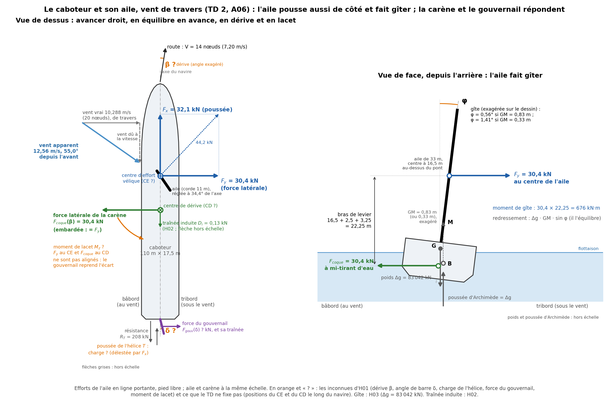

# TD 4 — Le bilan du navire : la carène, puis du newton au kilowatt · fiche élève

**EGN-S7 Propulsion assistée par le vent · séance de TD S4 · durée 3 h (une pause).** Prérequis : le cours du 23/11,
deck S03 sur Vega (diapos 31 : efforts dans le repère navire ; 32 : les deux termes du gain ; 34 : 2 221 → 1 828 kW) ;
le cours sur les technologies et systèmes (Vega), parties « Hydrodynamique et équilibre du navire » et « Modélisation
du navire » ; les TD 1 à 3 (cas de l'aile du caboteur, théorie des bandes et NLL, rotor d'A12).

**La question du jour : que gagne-t-on vraiment au moteur ?** Depuis le TD 1, on suit le **caboteur** d'école (110 m,
résistance connue) et son **aile** de 33 m posée sur le pont, à 14 nœuds, dans un vent vrai de 20 nœuds (10,288 m/s) de
travers. Le TD 2 a donné ce que l'aile produit, en ligne portante, pied libre : **F_x = 32,1 kN** de poussée et
**F_y = 30,4 kN** de force latérale (A06). Les TD 1 à 3 ont regardé l'air. Ce TD regarde l'eau : la **carène**, qui doit
reprendre la force latérale et la gîte (partie 1), puis le **moteur**, qui ne voit pas F_x mais ce qu'il en reste au
bout de la chaîne propulsive (partie 2). Vous finissez par un **bilan chiffré d'une page**.

Les exercices sont tirés de la banque d'exercices d'EGN-S7 (H01 à H04, M01, M03, M05, et M07 en variante). Chaque
exercice porte son **niveau** : **niveau 1**, application directe d'une définition ou d'une formule ; **niveau 2**,
enchaînement de plusieurs étapes ou lecture critique d'une source ; **niveau 3**, étude ouverte. Chaque question porte
aussi sa **place** : *en séance*, *au compte rendu*, *travail personnel* (rendu avec le compte rendu) ou *variante*
(groupes rapides).

# Objectifs

À la fin de la séance, vous savez :

- écrire les quatre équilibres d'un navire à propulsion vélique et en nommer les inconnues (H01, niveau 1) ;
- dire pourquoi la carène **dérive** pour porter la force latérale, et chiffrer la **traînée induite** que cela coûte
  (H02, niveau 2) ;
- chiffrer la **gîte** due à l'aile et au rotor du TD 3, et dire quand elle compte (H03, niveau 2) ;
- dire pourquoi le **gouvernail** coûte, et pourquoi on ne peut pas le chiffrer ici (H04, niveau 1) ;
- passer de F_x à la **puissance utile**, puis à l'économie de puissance à l'hélice, et dire ce qu'oublie la formule
  simple (M05, niveau 2) ;
- montrer que le partage du gain en « 70 % de poussée, 30 % d'hélice » est une **convention** (M03, niveau 2) ;
- lire la table d'un logiciel de prédiction de performances et choisir un **mode de pilotage** (M01, niveau 1) ;
- *(variante)* tracer la **polaire** de l'aile du caboteur avec l'outil, et juger de sa fiabilité (M07, niveau 3).

# Vos armes : les formules et les données utiles

**Le caboteur** (le même qu'aux TD 1 à 3) : longueur L = 110 m, largeur B = 17,5 m, tirant d'eau T = 6,5 m, creux
9,0 m (le pont est à 2,5 m au-dessus de la flottaison), déplacement Δ = 8 465 t ; vitesse V = 14 nœuds = 7,20 m/s ;
eau de mer $`\rho = 1\,025`$ kg/m³ ; résistance à 14 nœuds sans voile **R_T = 208 kN** ; hauteur métacentrique
**GM = 0,83 m** (chargement courant ; 0,33 m pour un navire peu raide) ; $`g = 9{,}81`$ m/s².

**L'aile** (TD 1 et 2) : 33 m de haut, du pont à 35,5 m au-dessus de la flottaison, centre à 16,5 m au-dessus du pont ;
363 m². En ligne portante, pied libre : F_x = 32,1 kN, F_y = 30,4 kN ; en théorie des bandes : 45,0 et 34,2 kN.
**Le rotor** 35 × 5 m du TD 3 (A12, SR = 3) : F_y = 130,4 kN, centre à 17,5 m au-dessus du pont.

**Les quatre équilibres** (figure 1 ; cours sur les technologies et systèmes, partie « Modélisation du navire ») :
en avance (cavalement), en dérive (embardée), en lacet, et en roulis (gîte).

**Traînée induite de la carène** (formule de Prandtl, comme pour une aile ; la carène en dérive est une aile très
courte, couchée dans l'eau) :

```math
D_{i} = \frac{F_{y}^{2}}{\pi \, AR_{e} \, q \, A}, \qquad q = \frac{1}{2} \rho V^{2}, \qquad A = L \, T, \qquad AR_{e} = \frac{2 T}{L} \ \text{(hypothèse)}
```

**Gîte statique** : le moment de gîte de la force latérale est repris par le redressement du navire,

```math
\Delta g \cdot GM \cdot \sin\varphi = M = F_{y} \cdot b
```

où b est le bras de levier, du centre de l'aile au centre du plan de dérive de la carène (pris à mi-tirant d'eau).

**Du newton au kilowatt** (deck S03, diapos 31, 32 et 34) :

- puissance **utile** de l'aile : $`P_{x} = F_{x} \, V`$ ;
- rendement propulsif du navire sans voile : $`\eta_{D} = \frac{R_{T} \, V}{P_{D}}`$, où $`P_{D}`$ est la puissance livrée à
  l'hélice ; pour le caboteur, $`P_{D} = 2\,221`$ kW sans voile ;
- poussée demandée à l'hélice avec l'aile : $`T \, (1 - t) = R_{T} + D_{i} - F_{x}`$, avec le coefficient de succion
  $`t = 0{,}1915`$ ;
- « formule simple » de l'économie à l'hélice : $`\Delta P_{D} \approx \frac{F_{x} \, V}{\eta_{D}}`$.

# Matériel

- Une calculatrice ; un tableur pour la variante.
- **Le dépôt du TD**, `~/TD-Propulsion-Velique`, à mettre à jour (`git pull`) : le TD 4 est dans le dossier
  `TD4_bilan-du-navire/`. La partie 1 et la partie 2 se font **sans l'outil** ; l'outil (**CN-AeroModels v0.5.1**, dans
  **Ubuntu sous Windows**, installé au TD 1) sert à la polaire, qui tourne **en arrière-plan** pendant la partie 1.
- Les énoncés d'H01, M01, M03, M02 et M04, **sur Vega** (ils s'appuient sur des supports de formation non libres).

| Manipulation | Dossier (dans `~/TD-Propulsion-Velique/TD4_bilan-du-navire/`) | Commande |
|---|---|---|
| Figure 1 — les forces sur le navire (H01) | — (à la racine de `TD4_bilan-du-navire/`) | à ouvrir : `forces-sur-le-navire.png` |
| Polaire en arrière-plan (début de séance) | `variante_polaire-aile-caboteur/` | `bash lancer.sh FOND` |
| Où en est la polaire ? | `variante_polaire-aile-caboteur/` | `bash lancer.sh ETAT` |
| Variante V-polaire — un angle de plus | `variante_polaire-aile-caboteur/` | `bash lancer.sh 90` |
| Variante V-polaire — convergence en maillage | `variante_polaire-aile-caboteur/` | `bash lancer.sh CONVERGENCE` |

Table: Tableau 1 — Où travailler : la figure et la polaire

`lancer.sh` lance l'outil, range tout dans `sorties/` du dossier (`polaire.csv`, `polaire.png` ; pour chaque angle,
`TWA_NNN/ecran.txt`, ce que l'outil a affiché) et ne modifie jamais le fichier fourni `aile-caboteur-polaire.yml`.

> **Rappels des TD 1 à 3.** Pour ouvrir depuis Windows un fichier du dépôt (une image, un `.csv` dans le tableur), ne
> **retapez jamais** le chemin : dans le terminal Ubuntu, placez-vous dans le dossier voulu, tapez `wslpath -w .`, puis
> copiez l'adresse affichée (sélection à la souris, **Ctrl+Maj+C**) et collez-la dans l'explorateur Windows.

# Déroulé de la séance

- **Ouverture (10 min)** : la question du jour ; **lancement de la polaire en arrière-plan** (ci-dessous).
- **Partie 1, la carène (≈ 1 h 20)** : H01 (énoncé sur Vega, figure 1), H02, H03, H04.
- **Pause.**
- **Partie 2, du newton au kilowatt (≈ 1 h 20)** : M05, M03 (énoncé sur Vega), M01 (énoncé sur Vega).
- **Bilan chiffré (10 min)** : « le caboteur et son aile », une page.
- **Variante V-polaire** (groupes rapides, M07) : la polaire lancée en début de séance.
- **Travail personnel**, rendu avec le compte rendu : M02 et M04 (énoncés sur Vega).

# Avant tout : lancer la polaire en arrière-plan (5 min)

*(en séance, tous les binômes)* La polaire de l'aile du caboteur (16 calculs, l'angle du vent vrai de 30° à 180° par
pas de 10°) est longue : **de 15 à 25 minutes sur un portable** (c'est une estimation ; 12 minutes mesurées sur un
portable récent). On la lance maintenant, elle tourne pendant la partie 1 :

```bash
cd ~/TD-Propulsion-Velique
git pull
cd TD4_bilan-du-navire/variante_polaire-aile-caboteur
bash lancer.sh FOND
```

Le terminal rend la main tout de suite : la polaire tourne derrière, sur tous les cœurs de la machine sauf un. **Ne
fermez pas cette fenêtre Ubuntu** avant la fin : ouvrez-en une seconde si vous avez besoin d'un terminal. Pour voir où
en est le calcul, à tout moment, dans le même dossier :

```bash
bash lancer.sh ETAT
```

Il répond « Polaire en cours : N angles finis sur 16 » (avec l'heure de lancement), puis « Polaire finie » ; le tracé est alors dans
`sorties/polaire.png`. Ce que le script affiche pendant le calcul est dans `sorties/polaire_ecran.txt`.

# Partie 1 — La carène



La figure 1 dit tout le message de la partie 1 : **l'aile pousse aussi de côté et fait gîter ; la carène et le
gouvernail répondent.** Pour porter les 30,4 kN de force latérale, la carène avance un peu **en crabe**, à l'angle de
dérive β : c'est cette dérive qui fait naître sa force latérale. Le gouvernail, à l'angle δ, rattrape le moment de
lacet ; la gîte φ est reprise par la stabilité du navire.

## H01 — Les quatre équations d'équilibre · niveau 1

*(en séance)* **Énoncé sur Vega** : il s'appuie sur un support de formation non libre. Appuyez-vous sur la figure 1,
où sont marquées en orange les grandeurs que vous aurez à nommer.

## H02 — Traînée induite de la carène · niveau 2

*(en séance)* Avec la formule de Prandtl des « armes » (A = L T, $`AR_{e} = 2T/L`$, hypothèse) :

1. Calculez q, A et $`AR_{e}`$, puis la traînée induite $`D_{i}`$ de la carène pour une aile (F_y = 34,2 kN, théorie des
   bandes) et pour deux ailes (68,4 kN). Retrouvez **0,17 kN** et **0,66 kN**.
2. Refaites le calcul avec $`AR_{e}`$ divisé par deux.
3. Refaites-le avec la force latérale du fil du TD, en ligne portante : 30,4 kN par aile.
4. Comparez à R_T = 208 kN. Compte-t-elle ? Pour quel navire compterait-elle ?

## H03 — Gîte statique : aile ou rotor · niveau 2

*(en séance)* Le bras de la force latérale va du centre de l'aile (16,5 m au-dessus du pont) au centre du plan de
dérive (mi-tirant d'eau). On écrit $`\Delta g \, GM \sin\varphi = M`$.

1. Calculez le bras, puis la gîte pour GM = 0,83 m et 0,33 m, avec une et deux ailes (F_y = 34,2 kN par aile), puis avec
   le rotor d'A12 à SR = 3 (F_y = 130,4 kN, centre à 17,5 m au-dessus du pont).
2. Refaites le cas d'une aile avec la force latérale en ligne portante (30,4 kN). Retrouvez-vous les gîtes de la
   figure 1 ?
3. Quelle technologie fait le plus gîter, et à quel navire cela pose-t-il problème ?

## H04 — Ce que coûte le gouvernail · niveau 1

*(en séance)* Pourquoi le gouvernail réduit-il le gain ? Que faudrait-il pour le chiffrer ? Dites ce que la figure 1
montre et ce qu'elle laisse en « ? ».

# Partie 2 — Du newton au kilowatt

## M05 — De F_x à l'économie au moteur · niveau 2

*(en séance)* Pour le caboteur avec une aile, que faut-il de plus pour passer de **F_x = 32,1 kN** (A06, NLL) à une
économie au moteur ? Procédez en quatre temps :

1. Calculez la puissance **utile** de l'aile, $`P_{x} = F_{x} V`$, et ce qu'elle représente de $`P_{D} = 2\,221`$ kW.
2. Calculez $`\eta_{D}`$ du caboteur sans voile, puis l'économie à l'hélice par la formule simple
   $`F_{x} V / \eta_{D}`$.
3. Le calcul complet de la chaîne (deck S03, diapo 34 ; l'hélice délestée y est recalculée à son nouveau point de
   fonctionnement) donne $`P_{D}`$ de **2 221 à 1 828 kW**. Quelle est l'économie, en kW et en % ? De combien la
   formule simple la sous-estime-t-elle, et pourquoi (diapo 32) ?
4. De $`P_{D}`$ au carburant : quels maillons manquent encore (arbre, moteur, consommation spécifique) ? Que faudrait-il
   connaître du moteur ?

## M03 — Gain vélique : la répartition 70/30 est une convention · niveau 2

*(en séance)* **Énoncé sur Vega** : il s'appuie sur un support de formation non libre (deck S03, diapo 32, en est tiré).

## M01 — La table 5D d'un PPP et les modes de pilotage · niveau 1

*(en séance)* **Énoncé sur Vega** : il s'appuie sur un support de formation non libre.

# Bilan chiffré : « le caboteur et son aile » (10 min)

*(en séance, puis au compte rendu)* Une page, un tableau et cinq lignes. Remplissez le tableau avec **vos** valeurs
(une aile, ligne portante, pied libre, 14 nœuds, vent vrai de 20 nœuds de travers), puis répondez en cinq lignes à la
question du jour : **que gagne-t-on vraiment au moteur ?**

| Poste | Valeur | D'où elle vient |
|---|---|---|
| Gain brut : poussée F_x ; puissance utile F_x V | … kN ; … kW | A06 ; M05, 1 |
| Traînée induite de la carène D_i ; ce qu'elle retire en puissance (D_i V) | … kN ; … kW | H02 |
| Gîte (GM = 0,83 m) | … ° | H03 |
| Gouvernail | non chiffré | H04 |
| Gain à l'hélice : formule simple ; chaîne complète | … kW ; … kW (… % de P_D) | M05, 2 et 3 |
| Gain au moteur, en ordre de grandeur | … kW | M05, 4 |
| Ce que le TD n'a pas modélisé | à lister | H01, H04, M05 |

Table: Tableau 2 — Le bilan du caboteur et de son aile

# Variante V-polaire — La polaire de l'aile du caboteur (M07) · niveau 3

*(variante, groupes rapides)* La polaire lancée en début de séance balaie l'angle du vent vrai (TWA, compté depuis
l'avant) de 30° à 180° par pas de 10°, navire à 14 nœuds, vent vrai de 20 nœuds. Pour chaque angle, l'outil cherche
lui-même le réglage de l'aile qui donne la plus grande poussée (`control: maxThrust`), en ligne portante non linéaire,
pied libre, 20 éléments. Vérifiez d'abord qu'elle est finie (`bash lancer.sh ETAT`), puis ouvrez `sorties/polaire.png`
et `sorties/polaire.csv` (colonnes : TWA, nombre d'éléments, AWS, AWA, réglage, F_x, F_y).

- **V1.** Où est le maximum de poussée F_x ? Calculez $`C_{x} = F_{x} / (q_{air} \, A)`$, avec
  $`q_{air} = \frac{1}{2} \, 1{,}225 \, \mathrm{AWS}^{2}`$ et A = 363 m², pour chaque angle (tableur) : où est le maximum de
  $`C_{x}`$ ? Pourquoi les deux maxima diffèrent-ils ?
- **V2.** Le point du TD 2 (A06, l'étoile de la figure, réglage fixé à 34,4°) est sous la courbe à 90°. Pourquoi ?
- **V3.** Jusqu'à quel angle le résultat est-il crédible ? (Regardez le réglage retenu et l'incidence qu'il donne, et
  souvenez-vous de la table de profil du TD 1.)
- **V4.** Que manque-t-il pour une polaire « 5D » au sens d'un logiciel de prédiction de performances (M01) ?
- **V5.** Relancez un angle déjà calculé (`bash lancer.sh 90`, 2 à 7 min) et comparez F_x et le réglage à ceux de la
  polaire. `maxThrust` cherche le réglage par un **algorithme génétique**, c'est-à-dire en partie au hasard. Que
  faudrait-il pour une courbe fiable ? Le creux éventuel de votre courbe est-il physique ?
- **V6.** `bash lancer.sh CONVERGENCE` (quelques secondes) refait le vent de travers à réglage fixé, avec 10, 20, 30 et
  40 éléments. La polaire à 20 éléments est-elle convergée en maillage ? Que se passe-t-il au-delà ?

# Question d'interprétation physique

*(au compte rendu)* La traînée induite de l'aile (TD 2) faisait perdre près de 30 % de sa poussée ; celle de la carène
coûte moins de 1 % de la résistance. Les deux suivent pourtant la même formule. D'où vient la différence (comparez q,
la surface et l'allongement) ? Pour quel navire la conclusion s'inverserait-elle, et que deviendrait alors votre bilan ?

# Ce qu'il faut rendre

Un compte rendu (une à deux pages, plus le bilan), selon les consignes de dépôt données par l'enseignant, avec :

1. les réponses d'H01 à H04, **calculs posés** et unités ; pour H03, un tableau des gîtes ;
2. les réponses de M05, M03 et M01 ;
3. le **bilan chiffré** « le caboteur et son aile » (tableau 2 et cinq lignes) ;
4. votre réponse à la question d'interprétation, en cinq lignes au plus ;
5. en **travail personnel**, M02 et M04 (énoncés sur Vega) ;
6. si vous avez fait la variante : la polaire (`sorties/polaire.png`) et vos réponses à V1 à V6 ; sinon, au moins
   l'état de votre polaire (`bash lancer.sh ETAT`) et, si elle a échoué, le message d'erreur
   (`sorties/polaire_ecran.txt`).

# Sources

- Cours EGN-S7 du 23/11, deck S03 « Aérodynamique et passage au TD » (Vega), diapos 31, 32 et 34 ; cours sur les
  technologies et systèmes (Vega), parties « Hydrodynamique et équilibre du navire » et « Modélisation du navire ».
- L. Larsson, R. Eliasson et M. Orych, *Principles of Yacht Design*, 5e éd., Adlard Coles, 2022, chapitre 6 (formule
  de Prandtl de la traînée induite, appliquée ici à la carène).
- Le caboteur d'école de l'ENSM (données du cours de performances du navire, EGN-S9) : dimensions, résistance, hélice ;
  la chaîne propulsive avec une aile (2 221 → 1 828 kW, deck S03, diapo 34) en est tirée.
- CN-AeroModels v0.5.1, A. Babarit et M. Charlou, LHEEA, <https://gitlab.com/lheea/CN-AeroModels> (EPL 2.0) ; cas de
  l'aile du caboteur (`aile-caboteur-polaire.yml`, dérivé de l'exemple 1, copie tracée dans `PROVENANCE.md`).
- Figure 1 : ENSM (CC BY 4.0), dessinée par script d'après les valeurs des TD 2 et 3 et de ce TD.
- Banque d'exercices EGN-S7, exercices H01 à H04, M01 à M05 et M07 ; dépôt public du TD, `TD-Propulsion-Velique`.
